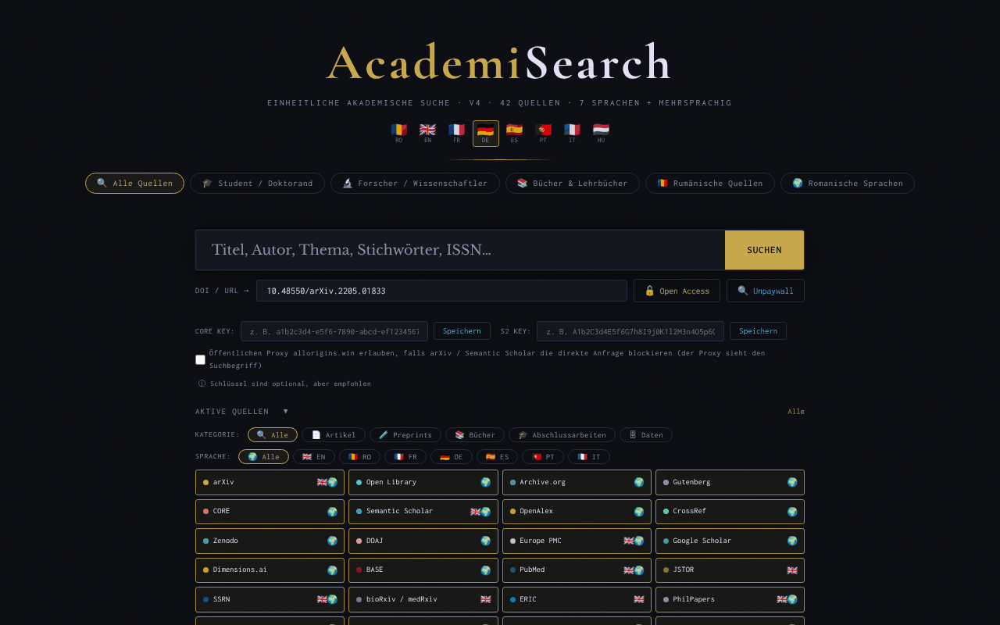

# AcademiSearch

[English](README.md) · [Română](README.ro.md) · [Français](README.fr.md) · [Italiano](README.it.md) · [Español](README.es.md) · [Português](README.pt.md) · **Deutsch** · [Magyar](README.hu.md)

**Version:** 5.1.0 · **Zuletzt aktualisiert:** 2026-10-27

**Status:** stabil · **Offline:** braucht Internet für die Suche (Quellen-APIs)

Oberflächensprachen: **Română, English, Français, Italiano, Español, Português (PT), Deutsch, Magyar**

Eine einheitliche akademische Suchmaschine in einer einzigen HTML-Datei: 42 Open-Access-Quellen, 8 Oberflächensprachen.

**Online-Anwendung:** https://chiuta.github.io/AcademiSearch/

## Was es ist

AcademiSearch ist eine Anwendung in einer einzigen Datei `index.html`, die mehrere akademische Quellen gleichzeitig abfragt (Artikel, Preprints, Bücher, Abschlussarbeiten, Forschungsdaten) und die Ergebnisse in einem gemeinsamen Fenster anzeigt. Bei einem Teil der Quellen werden die Ergebnisse direkt über eine API abgerufen; für die übrigen bietet die Anwendung einen direkten Link zur Suchseite des jeweiligen Portals. Laut dem Text in der Anwendung gibt es 42 Quellen: 11 mit Live-Ergebnissen über eine API und 31 Portale mit direktem Link.

## Funktionen

- Oberfläche in 8 Sprachen: Rumänisch, Englisch, Französisch, Deutsch, Spanisch, Portugiesisch, Italienisch, Ungarisch (Schaltflächen RO / EN / FR / DE / ES / PT / IT / HU).
- Suchvoreinstellungen: „Alle Quellen“, „Student / Doktorand“, „Forscher / Lehrkraft“, „Bücher & Lehrbücher“, „Rumänische Quellen“, „Romanische Sprachen“.
- Ein Bereich „Aktivierte Quellen“ mit einzelnem Anhaken der Quellen.
- Filter nach Kategorie (Artikel, Preprint, Bücher, Abschlussarbeiten, Daten) und nach Sprache (EN, RO, FR, DE, ES, PT, IT).
- Ergebnisse mit den Filtern „Mit PDF“ und „Mit DOI“ und schrittweisem Nachladen der Ergebnisse.
- Ein Feld „DOI / URL“ mit den Schaltflächen „Freier Zugang“ und „Unpaywall“: Die Anwendung sucht eine Open-Access-Version über CrossRef (wenn die DOI fehlt), Unpaywall, OpenAIRE und eine Titelsuche in Unpaywall.
- Optionale Felder für einen CORE-API-Schlüssel und einen Semantic-Scholar-API-Schlüssel.
- Export der gefilterten Ergebnisse als BibTeX, RIS oder CSV (lokal im Browser erzeugte Datei, ohne Netzwerkanfragen). Die Autorenliste wird so exportiert, wie die Quelle sie liefert (manche Quellen kürzen die Liste), und CSV-Felder, die mit `=`, `+`, `-` oder `@` beginnen, werden neutralisiert.
- Das Feld „DOI / URL“ bereinigt die Präfixe (`doi:`, `https://doi.org/`) und zeigt eine klare Meldung an, wenn das DOI-Format ungültig ist.
- Die Taste `/` setzt den Fokus auf das Suchfeld; die Suchen der aktuellen Sitzung werden vorgeschlagen (es wird nichts gespeichert).
- Ein Fenster „Rechtliche Hinweise & DSGVO“, angezeigt in der Oberflächensprache: Der rumänische Text ist das Original; die Übersetzungen in die übrigen 7 Sprachen (11 Abschnitte) sind automatisch, fügen keine Klauseln hinzu und **müssen von einer juristischen Fachperson geprüft werden**.
- Die Beschreibungen der 42 Quellen (Chips, Tooltips, Abschnittsüberschriften und Portalkarten) sind in allen 8 Sprachen verfügbar; die Übersetzungen außer RO und EN sind automatisch und nicht von Muttersprachlern geprüft.

## Neue Funktionen (4.1.0)

- **Sortierung nach Relevanz** der gefilterten Ergebnisse im Ergebnisfenster: lokale Suche (BM25, Toleranz gegenüber Tippfehlern, diakritische Zeichen ignoriert) über die bereits abgerufenen Titel und Zusammenfassungen; der alte wörtliche Abgleich bleibt erhalten. Sie stellt keine Netzwerkanfragen.
- **„Meine Bibliothek“**: Schaltflächen zum Speichern/Entfernen auf jeder Karte; ein Fenster mit Suche in der Bibliothek, BibTeX- / RIS- / CSV-Export und zweistufigem Löschen. Höchstens 500 Einträge, nur in diesem Browser gespeichert.
- Sicherungskopie `.fff.json` (gemeinsames Modul „fff-kit“, lokal, ohne Netzwerk): Sie öffnet sich über den Dialog, der beim Klick auf die Version in der Fußzeile erscheint (Export, passwortverschlüsselter Export, Import mit Bestätigung, Löschen der Anwendungsdaten). Die Kopie enthält die Bibliothek und die Oberflächensprache.
- Die neuen Texte der Bibliothek liegen auf Rumänisch, Englisch, Französisch, Deutsch, Spanisch, Portugiesisch, Italienisch und Ungarisch vor; **die Übersetzungen wurden nicht von Muttersprachlern geprüft.**

## Anleitung

1. Öffnen Sie die Seite und wählen Sie die Oberflächensprache in der oberen Ecke (RO, EN, FR, DE, ES, PT, IT, HU).
2. Wählen Sie eine Voreinstellung (zum Beispiel „Student / Doktorand“) oder öffnen Sie „Aktivierte Quellen“ und haken Sie die gewünschten Quellen manuell an.
3. Optional können Sie nach KATEGORIE und SPRACHE eingrenzen.
4. Geben Sie den Begriff in das Suchfeld ein und drücken Sie die Eingabetaste oder die Schaltfläche „SUCHEN“.
5. Verwenden Sie im Ergebnisfenster die Filter „Mit PDF“ / „Mit DOI“; schließen Sie mit „Schließen“ oder der Escape-Taste.
6. Fügen Sie für einen bekannten Artikel die DOI oder URL in das Feld „DOI / URL“ ein und drücken Sie „Freier Zugang“ (oder „Unpaywall“).
7. Für CORE und Semantic Scholar können Sie den API-Schlüssel eingeben und „Speichern“ drücken (die Schlüssel sind optional).

## Datenschutz und Netzwerk

- Lokal: Die Oberflächensprache wird im `localStorage` gespeichert (`academisearch.lang`); die persönliche Bibliothek im `localStorage` (`academisearch.library`, höchstens 500 Einträge, sie verlässt den Browser nicht); eingegebene API-Schlüssel werden im `sessionStorage` gespeichert und verschwinden beim Schließen des Tabs. Die Anwendung verwendet keine Cookies.
- Netzwerk: Die Anwendung ist NICHT offline. Bei jeder Suche wird der gesuchte Begriff direkt vom Browser an die aktiven externen Dienste gesendet: OpenAlex, CrossRef, CORE, Semantic Scholar, arXiv, Europe PMC (ebi.ac.uk), DOAJ, Zenodo, Open Library, Internet Archive, Project Gutenberg (gutendex.com). Bei „Freier Zugang“ / „Unpaywall“ werden CrossRef, Unpaywall und OpenAIRE kontaktiert.
- CORS-Proxy (Opt-in, standardmäßig deaktiviert): arXiv und Semantic Scholar werden direkt abgefragt. Nur wenn Sie ausdrücklich „Öffentlichen Proxy allorigins.win erlauben“ anhaken (neben den Feldern für API-Schlüssel; gültig für die Dauer des Tabs) und der Browser die direkte Anfrage blockiert (CORS), wird diese Anfrage über `api.allorigins.win` erneut gesendet, das die Abfrage-URL (den gesuchten Begriff) sehen kann. Die API-Schlüssel laufen niemals über den Proxy.
- Anfragen an OpenAlex und Unpaywall enthalten die Kontaktadresse des Betreibers (`academisearch@alexio.tf`), gemäß der „Polite-Pool“-Konvention.
- Die Portale mit direktem Link werden nur kontaktiert, wenn Sie den Link öffnen.
- Schriften/CDN: beim Audit geprüft (2026-10-10): Es werden keine Skripte, Schriften oder Stile von einem CDN geladen; die Schriften sind eingebettet, und die CSP-Richtlinie der Seite (`connect-src`; `script-src` mit Hash, ohne `unsafe-inline`) beschränkt die Anfragen auf die oben genannten Hosts.

## Lokale Ausführung / offline

Laden Sie `index.html` herunter und öffnen Sie sie in einem Browser. Die Oberfläche startet lokal, aber die Suche erfordert eine Internetverbindung.

## Verlauf / Changelog

### 4.3.12 — 2026-10-23
- Die Speicherschlüssel tragen jetzt das App-Präfix (`academisearch.lang`, `academisearch.library`); vorhandene Daten (Sprache, gespeicherte Bibliothek) werden beim Start automatisch migriert, alte `.fff.json`-Kopien lassen sich weiterhin importieren.
- fff-kit 1.2.0: Speicher ohne Präfix behoben

### 4.3.10 — 2026-10-22
- fff-kit 1.1.4: Touch-Ziele und Mindestschriftgröße

### 4.3.9 — 2026-10-22
- Barrierefreiheit: deutlicher Fokusring am Hauptsuchfeld sowie an den Feldern DOI, API-Schlüssel, Bibliothek und interne Suche (Kontrast von mindestens 3:1).

### 4.3.8 — 2026-10-22
- Touch-Ziele: Die Schaltfläche „Meine Bibliothek“ in der Fußzeile ist jetzt mindestens 28 px hoch (CSS-Spezifität korrigiert).

### 4.3.7 — 2026-10-22
- fff-kit 1.1.2: PBKDF2 mit 600.000 Iterationen, Schutz vor Clickjacking

### 4.3.6 — 2026-10-22
- Status pro Quelle im Ergebnisfenster: Jede API-Quelle zeigt OK, Ratenlimit, Zeitüberschreitung oder blockiert/CORS, dazu eine sichtbare Schaltfläche „Fehlgeschlagene Quellen erneut versuchen“ mit Backoff (2 s, 4 s …).
- Sitzungs-Cache der Ergebnisse im Speicher pro Quelle und Suchanfrage (weniger 429-Fehler bei wiederholten Suchen).
- Mobil: kein Text unter 12 px und Touch-Ziele von mindestens 24 px (WCAG 2.5.8).

### 4.3.5 — 2026-10-22
- Übersetzungskorrektur: Beschreibung (und Name) im Transparenzfenster folgen jetzt der Oberflächensprache.

### 4.3.4 — 2026-10-22
- Der Seitentitel, der Zähler „Suche läuft…“ und das aria-label der Bibliothekssuche folgen jetzt der Oberflächensprache.

### 19. Oktober 2026 (v4.3.1–4.3.3)
- Die Beschreibungen der 42 Quellen und das Fenster „Rechtliche Hinweise & DSGVO“ sind in alle 8 Sprachen übersetzt (der rumänische Rechtstext bleibt das Original; die Übersetzungen müssen juristisch geprüft werden).
- Behoben: Dem Dialog „Meine Bibliothek“ fehlten die Themenfarben (Text auf dem dunklen Thema unlesbar); er verwendet jetzt die Themenvariablen.

### 18. Oktober 2026 (v4.2.0)
- Neu: Einstiegslink `#q=<Begriff>` (z. B. aus Nota Zero), der nur das Suchfeld vorausfüllt; die Suche startet nicht von selbst, und das Fragment wird nach dem Lesen aus der Adresse entfernt.

### 18. Oktober 2026 (v4.1.1)
- Quellen, die nicht mehr rot/blockiert bleiben: arXiv (ohne CORS) wechselt automatisch auf die arXiv-Preprints in OpenAlex; CORE ohne Schlüssel wechselt auf OpenAIRE, dann auf die OA-Repositorien in OpenAlex; Semantic Scholar versucht es nach einem 429 erneut und wechselt dann auf OpenAlex; Gutenberg hat ein Timeout von 8 s und einen Fallback auf die Gutenberg-Sammlung bei Archive.org.
- Jede Quelle hat ein Timeout von 30 s, und der Fehlergrund erscheint als Tooltip auf dem roten Chip.

### 14. Oktober 2026 (v4.1.0)
- Lokale Sortierung nach Relevanz im Ergebnisfenster (FFF.search).
- „Meine Bibliothek“ (`localStorage`-Schlüssel `academisearch.library`) mit Suche und BibTeX/RIS/CSV-Export.
- Sicherungskopie `.fff.json` über die gemeinsamen Module (core, label, bundle, search); die Version wird in der Fußzeile angezeigt.
- Neue Tests: `tests/fff-r8.test.mjs`.

### 12. Oktober 2026 (v4.0.4)
- 4.0.4 — 2026-10-12: Die Version und das Datum der letzten Aktualisierung werden in der Anwendung angezeigt

### 11. Oktober 2026 (v4.0.3)
- Die auf 360-px-Bildschirmen abgeschnittene Schaltfläche SUCHEN wurde korrigiert und kleine Touch-Ziele (Schaltflächen, Filter, Kästchen) wurden vergrößert.
- Die Taste „/“ setzt den Fokus auf das Suchfeld; die Suchen der aktuellen Sitzung erscheinen als Vorschläge (nur im Speicher, nicht gespeichert).

### 11. Oktober 2026 (v4.0.3)
- Sicherheit: Alle 34 Inline-Attribute `on*` wurden durch einen delegierten Dispatcher ersetzt (`data-act` + ein einziger Listener); die CSP-Richtlinie verwendet jetzt `script-src` mit Hash, ohne `'unsafe-inline'` für Skripte.
- BibTeX- / RIS- / CSV-Export der gefilterten Ergebnisse; Meldungen in allen 7 Sprachen.
- Validierung und Bereinigung des DOI-Feldes, mit einer barrierefreien Fehlermeldung (`role="status"`).

### 11. Oktober 2026 (v4.0.1)
- Barrierefreiheit: Der Inhalt ist in <main> eingefasst, die Quellen sind jetzt Elemente mit gültiger `checkbox`-Rolle (axe: 0 Verstöße).
- Urheberrechtswarnung bei den Quellen 101books.club und Scribd Downloader hinzugefügt (Beschreibung/Tooltip), mit dem Hinweis, dass es sich nicht um Open-Access-Quellen handelt.
- Die Version im Fenster „Rechtliche Hinweise“ und das Aktualisierungsdatum: 4.0.1, 11. Oktober 2026.

## Lizenz

MIT — siehe Datei LICENSE

## Autor

Alexio — Alexandru-Ionuț Chiuță, Kontakt: alexio@trom.tf

## Zusammenfassung

AcademiSearch ist ein HTML-Metasuchwerkzeug in einer einzigen Datei über 42 akademische Open-Access-Quellen (11 mit Live-API-Ergebnissen, 31 als Portale mit direktem Link), mit einer Oberfläche in 8 Sprachen. Es ist nicht offline: Suchen gehen direkt vom Browser an APIs von Drittanbietern, und arXiv/Semantic Scholar können den CORS-Proxy allorigins.win nur verwenden, wenn Sie ein Opt-in-Kontrollkästchen ausdrücklich anhaken (standardmäßig aus). Gespeichert werden nur die Oberflächensprache (localStorage) und optionale API-Schlüssel (sessionStorage). MIT-Lizenz. Gefilterte Ergebnisse können als BibTeX, RIS oder CSV exportiert werden (lokal erzeugt).

Audit der Runde 2 (2026-10-11): Der Proxy allorigins.win wurde zum Opt-in. Audit: 2026-10-10 — geprüft wurden der Code (Netzwerkanfragen, Escaping der API-Ergebnisse, CORS-Proxy: API-Schlüssel werden nur im direkten Header gesendet, nie über den Proxy), die Barrierefreiheit (axe) und die Funktion (Offline-Suche: Quellenfehler werden behandelt). Die Zahl „42 Quellen“ stimmt: 11 API + 31 Portale.
