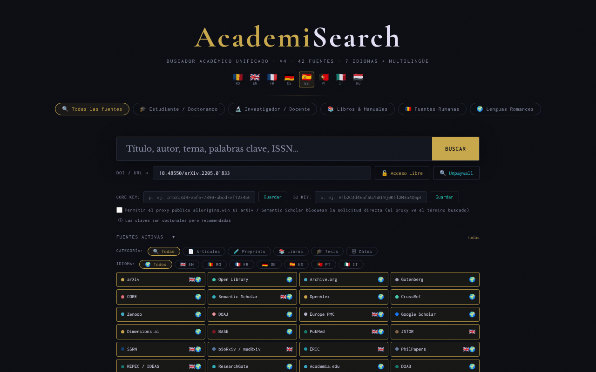

# AcademiSearch

[English](README.md) · [Română](README.ro.md) · [Français](README.fr.md) · [Italiano](README.it.md) · **Español** · [Português](README.pt.md) · [Deutsch](README.de.md) · [Magyar](README.hu.md)

**Versión:** 4.3.8 · **Última actualización:** 2026-10-22

Idiomas de la interfaz: **Română, English, Français, Italiano, Español, Português (PT), Deutsch, Magyar**

Un buscador académico unificado en un único archivo HTML: 42 fuentes de acceso abierto, 8 idiomas de interfaz.

**Aplicación en línea:** https://chiuta.github.io/AcademiSearch/

## Qué es

AcademiSearch es una aplicación contenida en un único archivo `index.html` que consulta simultáneamente varias fuentes académicas (artículos, preprints, libros, tesis, datos de investigación) y muestra los resultados en una ventana común. Para una parte de las fuentes los resultados se obtienen directamente mediante API; para el resto, la aplicación ofrece un enlace directo a la página de búsqueda del portal correspondiente. Según el texto de la aplicación, hay 42 fuentes: 11 con resultados en vivo mediante API y 31 portales con enlace directo.

## Funciones

- Interfaz en 8 idiomas: rumano, inglés, francés, alemán, español, portugués, italiano, húngaro (botones RO / EN / FR / DE / ES / PT / IT / HU).
- Ajustes preestablecidos de búsqueda: «Todas las fuentes», «Estudiante / Doctorando», «Investigador / Personal docente», «Libros y manuales», «Fuentes rumanas», «Lenguas románicas».
- Un panel «Fuentes activadas» con marcado individual de las fuentes.
- Filtros por categoría (Artículos, Preprint, Libros, Tesis, Datos) y por idioma (EN, RO, FR, DE, ES, PT, IT).
- Resultados con los filtros «Con PDF» y «Con DOI» y carga progresiva de los resultados.
- Un campo «DOI / URL» con los botones «Acceso libre» y «Unpaywall»: la aplicación busca una versión de acceso abierto mediante CrossRef (si falta el DOI), Unpaywall, OpenAIRE y una búsqueda por título en Unpaywall.
- Campos opcionales para una clave API de CORE y una clave API de Semantic Scholar.
- Exportación de los resultados filtrados a BibTeX, RIS o CSV (archivo generado localmente en el navegador, sin solicitudes de red). La lista de autores se exporta tal como la devuelve la fuente (algunas fuentes truncan la lista), y los campos CSV que empiezan por `=`, `+`, `-` o `@` se neutralizan.
- El campo «DOI / URL» limpia los prefijos (`doi:`, `https://doi.org/`) y muestra un mensaje claro cuando el formato del DOI no es válido.
- La tecla `/` lleva el foco al campo de búsqueda; se sugieren las búsquedas de la sesión actual (no se guarda nada).
- Una ventana «Términos legales y RGPD», mostrada en el idioma de la interfaz: el texto en rumano es el original; las traducciones a los otros 7 idiomas (11 secciones) son automáticas, no añaden cláusulas y **requieren la revisión de un especialista jurídico**.
- Las descripciones de las 42 fuentes (chips, sugerencias, títulos de sección y fichas de portal) están disponibles en los 8 idiomas; las traducciones distintas de RO y EN son automáticas y no han sido verificadas por hablantes nativos.

## Funciones nuevas (4.1.0)

- **Ordenación por relevancia** de los resultados filtrados en la ventana de resultados: búsqueda local (BM25, tolerancia a errores de escritura, signos diacríticos ignorados) sobre los títulos y resúmenes ya obtenidos; la antigua coincidencia literal se mantiene. No hace ninguna solicitud de red.
- **«Mi biblioteca»**: botones de guardar/quitar en cada tarjeta; una ventana con búsqueda en la biblioteca, exportación BibTeX / RIS / CSV y borrado en dos pasos. Un máximo de 500 registros, guardados solo en este navegador.
- Copia de seguridad `.fff.json` (módulo común «fff-kit», local, sin red): se abre desde el cuadro de diálogo que aparece al hacer clic en la versión del pie de página (exportación, exportación cifrada con contraseña, importación con confirmación, borrado de los datos de la aplicación). La copia incluye la biblioteca y el idioma de la interfaz.
- Los nuevos textos de la biblioteca están en rumano, inglés, francés, alemán, español, portugués, italiano y húngaro; **las traducciones no han sido verificadas por hablantes nativos.**

## Manual de uso

1. Abre la página y elige el idioma de la interfaz en la esquina superior (RO, EN, FR, DE, ES, PT, IT, HU).
2. Elige un ajuste preestablecido (por ejemplo «Estudiante / Doctorando») o abre «Fuentes activadas» y marca manualmente las fuentes deseadas.
3. Opcionalmente, restringe por CATEGORÍA e IDIOMA.
4. Escribe el término en el campo de búsqueda y pulsa Intro o el botón «BUSCAR».
5. En la ventana de resultados usa los filtros «Con PDF» / «Con DOI»; cierra con «Cerrar» o la tecla Escape.
6. Para un artículo conocido, pega el DOI o la URL en el campo «DOI / URL» y pulsa «Acceso libre» (o «Unpaywall»).
7. Para CORE y Semantic Scholar puedes introducir la clave API y pulsar «Guardar» (las claves son opcionales).

## Privacidad y red

- Local: el idioma de la interfaz se guarda en `localStorage` (`ui_lang`); la biblioteca personal, en `localStorage` (`as_library`, un máximo de 500 registros, no sale del navegador); las claves API introducidas se guardan en `sessionStorage` y desaparecen al cerrar la pestaña. La aplicación no usa cookies.
- Red: la aplicación NO funciona sin conexión. En cada búsqueda, el término buscado se envía a los servicios externos activos, directamente desde el navegador: OpenAlex, CrossRef, CORE, Semantic Scholar, arXiv, Europe PMC (ebi.ac.uk), DOAJ, Zenodo, Open Library, Internet Archive, Project Gutenberg (gutendex.com). Con «Acceso libre» / «Unpaywall» se contacta con CrossRef, Unpaywall y OpenAIRE.
- Proxy CORS (opt-in, desactivado por defecto): arXiv y Semantic Scholar se consultan directamente. Solo si marcas explícitamente «Permitir el proxy público allorigins.win» (junto a los campos de claves API; válido durante la pestaña) y el navegador bloquea la solicitud directa (CORS), esa solicitud se reenvía a través de `api.allorigins.win`, que puede ver la URL de la consulta (el término buscado). Las claves API nunca pasan por el proxy.
- Las solicitudes a OpenAlex y Unpaywall incluyen la dirección de contacto del operador (`academisearch@alexio.tf`), conforme a la convención del «polite pool».
- Los portales con enlace directo solo se contactan si abres el enlace.
- Fuentes tipográficas/CDN: verificado en la auditoría (2026-10-10): no hay scripts, fuentes ni estilos cargados desde un CDN; las fuentes están integradas, y la política CSP de la página (`connect-src`; `script-src` con hash, sin `unsafe-inline`) limita las solicitudes a los hosts indicados arriba.

## Ejecución local / sin conexión

Descarga `index.html` y ábrelo en un navegador. La interfaz arranca en local, pero la búsqueda requiere conexión a internet.

## Historial / Registro de cambios

### 4.3.8 — 2026-10-22
- Objetivos táctiles: el botón «Mi biblioteca» del pie de página mide ahora al menos 28 px de alto (corrección de especificidad CSS).

### 4.3.7 — 2026-10-22
- fff-kit 1.1.2: PBKDF2 600 000 iteraciones, protección anti-clickjacking

### 4.3.6 — 2026-10-22
- Estado por fuente en la ventana de resultados: cada fuente API muestra OK, límite de peticiones, tiempo agotado o bloqueado/CORS, y un botón visible «Reintentar las fuentes fallidas» con backoff (2 s, 4 s…).
- Caché de sesión en memoria de los resultados por fuente y consulta (menos errores 429 en búsquedas repetidas).
- Móvil: ningún texto por debajo de 12 px y áreas táctiles de al menos 24 px (WCAG 2.5.8).

### 4.3.5 — 2026-10-22
- Corrección de traducción: la descripción (y el nombre) del panel de transparencia siguen ahora el idioma de la interfaz.

### 4.3.4 — 2026-10-22
- El título de la página, el contador «Buscando…» y el aria-label de la búsqueda en la biblioteca ahora siguen el idioma de la interfaz.

### 19 de octubre de 2026 (v4.3.1–4.3.3)
- Las descripciones de las 42 fuentes y la ventana «Términos legales y RGPD» se traducen a los 8 idiomas (el texto jurídico en rumano sigue siendo el original; las traducciones requieren revisión jurídica).
- Corregido: el cuadro de diálogo «Mi biblioteca» no tenía los colores del tema (texto ilegible en el tema oscuro); ahora usa las variables del tema.

### 18 de octubre de 2026 (v4.2.0)
- Novedad: enlace de entrada `#q=<término>` (p. ej. desde Nota Zero) que solo rellena previamente el campo de búsqueda; la búsqueda no se inicia sola, y el fragmento se borra de la dirección tras leerlo.

### 18 de octubre de 2026 (v4.1.1)
- Fuentes que ya no se quedan en rojo/bloqueadas: arXiv (sin CORS) pasa automáticamente a los preprints de arXiv en OpenAlex; CORE sin clave pasa a OpenAIRE y luego a los repositorios OA de OpenAlex; Semantic Scholar reintenta tras un 429 y luego pasa a OpenAlex; Gutenberg tiene un tiempo de espera de 8 s y una alternativa en la colección Gutenberg de Archive.org.
- Cada fuente tiene un tiempo de espera de 30 s, y el motivo del error aparece como información emergente en el chip rojo.

### 14 de octubre de 2026 (v4.1.0)
- Ordenación local por relevancia en la ventana de resultados (FFF.search).
- «Mi biblioteca» (clave de `localStorage` `as_library`) con búsqueda y exportación BibTeX/RIS/CSV.
- Copia de seguridad `.fff.json` mediante los módulos comunes (core, label, bundle, search); versión mostrada en el pie de página.
- Pruebas nuevas: `tests/fff-r8.test.mjs`.

### 12 de octubre de 2026 (v4.0.4)
- 4.0.4 — 2026-10-12: la versión y la fecha de la última actualización se muestran en la aplicación

### 11 de octubre de 2026 (v4.0.3)
- Corregido el botón BUSCAR cortado en pantallas de 360 px y ampliadas las áreas táctiles pequeñas (botones, filtros, casillas).
- La tecla «/» lleva el foco al campo de búsqueda; las búsquedas de la sesión actual aparecen como sugerencias (solo en memoria, no se guardan).

### 11 de octubre de 2026 (v4.0.3)
- Seguridad: los 34 atributos `on*` en línea se sustituyeron por un despachador delegado (`data-act` + un único listener); la política CSP usa ahora `script-src` con hash, sin `'unsafe-inline'` para scripts.
- Exportación BibTeX / RIS / CSV de los resultados filtrados; mensajes en los 7 idiomas.
- Validación y limpieza del campo DOI, con un mensaje de error accesible (`role="status"`).

### 11 de octubre de 2026 (v4.0.1)
- Accesibilidad: el contenido está envuelto en <main>, las fuentes son ahora elementos con un rol `checkbox` válido (axe: 0 infracciones).
- Advertencia de derechos de autor añadida a las fuentes 101books.club y Scribd Downloader (descripción/información emergente), aclarando que no son fuentes de acceso abierto.
- La versión en la ventana «Términos legales» y la fecha de actualización: 4.0.1, 11 de octubre de 2026.

## Licencia

MIT — consulta el archivo LICENSE

## Autor

Alexio — Alexandru-Ionuț Chiuță, contacto: alexio@trom.tf

## Resumen

AcademiSearch es una herramienta HTML de metabúsqueda en un único archivo sobre 42 fuentes académicas de acceso abierto (11 con resultados en vivo mediante API, 31 como portales con enlace directo), con interfaz en 8 idiomas. No funciona sin conexión: las búsquedas van directamente del navegador a API de terceros, y arXiv/Semantic Scholar solo pueden usar el proxy CORS allorigins.win si marcas explícitamente una casilla opt-in (desactivada por defecto). Solo se guardan el idioma de la interfaz (localStorage) y las claves API opcionales (sessionStorage). Licencia MIT. Los resultados filtrados se pueden exportar como BibTeX, RIS o CSV (generados localmente).

Auditoría de la ronda 2 (2026-10-11): el proxy allorigins.win pasó a ser opt-in. Auditoría: 2026-10-10 — verificado el código (solicitudes de red, escape de los resultados de la API, proxy CORS: las claves API se envían solo en la cabecera directa, nunca a través del proxy), la accesibilidad (axe) y el funcionamiento (búsqueda sin conexión: errores de fuente gestionados). La cifra «42 fuentes» coincide: 11 API + 31 portales.
