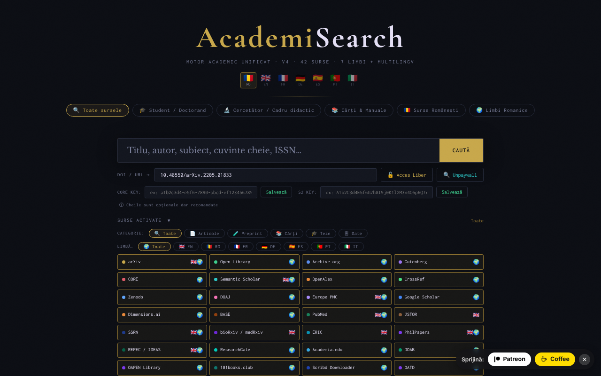

# AcademiSearch

[English](README.md) · [Română](README.ro.md) · **Français** · [Italiano](README.it.md) · [Español](README.es.md) · [Português](README.pt.md) · [Deutsch](README.de.md) · [Magyar](README.hu.md)

**Version :** 4.3.0 · **Dernière mise à jour :** 2026-10-19

Langues de l'interface : **Română, English, Français, Italiano, Español, Português (PT), Deutsch, Magyar**

Un moteur de recherche académique unifié dans un seul fichier HTML : 42 sources en libre accès, 8 langues d'interface.

**Application en ligne :** https://chiuta.github.io/AcademiSearch/

## Ce que c'est

AcademiSearch est une application contenue dans un seul fichier `index.html` qui interroge simultanément plusieurs sources académiques (articles, prépublications, livres, thèses, données de recherche) et affiche les résultats dans une fenêtre commune. Pour une partie des sources, les résultats sont récupérés directement par API ; pour les autres, l'application propose un lien direct vers la page de recherche du portail concerné. D'après le texte de l'application, il y a 42 sources : 11 avec des résultats en direct par API et 31 portails avec lien direct.

## Fonctions

- Interface en 8 langues : roumain, anglais, français, allemand, espagnol, portugais, italien (boutons RO / EN / FR / DE / ES / PT / IT / HU).
- Préréglages de recherche : « Toutes les sources », « Étudiant / Doctorant », « Chercheur / Enseignant », « Livres & Manuels », « Sources roumaines », « Langues romanes ».
- Un panneau « Sources activées » avec cochage individuel des sources.
- Filtres par catégorie (Articles, Prépublication, Livres, Thèses, Données) et par langue (EN, RO, FR, DE, ES, PT, IT).
- Résultats avec les filtres « Avec PDF » et « Avec DOI » et chargement progressif des résultats.
- Un champ « DOI / URL » avec les boutons « Accès libre » et « Unpaywall » : l'application recherche une version en libre accès via CrossRef (si le DOI manque), Unpaywall, OpenAIRE et une recherche par titre dans Unpaywall.
- Champs facultatifs pour une clé API CORE et une clé API Semantic Scholar.
- Export des résultats filtrés en BibTeX, RIS ou CSV (fichier généré localement dans le navigateur, sans requête réseau). La liste des auteurs est exportée telle que la source la renvoie (certaines sources tronquent la liste), et les champs CSV commençant par `=`, `+`, `-` ou `@` sont neutralisés.
- Le champ « DOI / URL » nettoie les préfixes (`doi:`, `https://doi.org/`) et affiche un message clair lorsque le format du DOI est invalide.
- La touche `/` place le focus dans le champ de recherche ; les recherches de la session en cours sont suggérées (rien n'est enregistré).
- Une fenêtre « Conditions légales & RGPD ».

## Nouvelles fonctions (4.1.0)

- **Tri par pertinence** des résultats filtrés dans la fenêtre des résultats : recherche locale (BM25, tolérance aux fautes de frappe, signes diacritiques ignorés) sur les titres et résumés déjà récupérés ; l'ancienne correspondance littérale demeure. Elle ne fait aucune requête réseau.
- **« Ma bibliothèque »** : boutons d'enregistrement/retrait sur chaque carte ; une fenêtre avec recherche dans la bibliothèque, export BibTeX / RIS / CSV et suppression en deux étapes. Au maximum 500 enregistrements, conservés uniquement dans ce navigateur.
- Copie de sauvegarde `.fff.json` (module commun « fff-kit », local, sans réseau) : elle s'ouvre depuis la boîte de dialogue qui apparaît en cliquant sur la version dans le pied de page (export, export chiffré par mot de passe, import avec confirmation, suppression des données de l'application). La copie comprend la bibliothèque et la langue de l'interface.
- Les nouveaux textes de la bibliothèque sont en roumain, anglais, français, allemand, espagnol, portugais et italien ; **les traductions n'ont pas été vérifiées par des locuteurs natifs.**

## Mode d'emploi

1. Ouvrez la page et choisissez la langue de l'interface dans le coin supérieur (RO, EN, FR, DE, ES, PT, IT, HU).
2. Choisissez un préréglage (par exemple « Étudiant / Doctorant ») ou ouvrez « Sources activées » et cochez manuellement les sources souhaitées.
3. Facultativement, affinez par CATÉGORIE et LANGUE.
4. Saisissez le terme dans le champ de recherche et appuyez sur Entrée ou sur le bouton « RECHERCHER ».
5. Dans la fenêtre des résultats, utilisez les filtres « Avec PDF » / « Avec DOI » ; fermez avec « Fermer » ou la touche Échap.
6. Pour un article connu, collez le DOI ou l'URL dans le champ « DOI / URL » et appuyez sur « Accès libre » (ou « Unpaywall »).
7. Pour CORE et Semantic Scholar, vous pouvez saisir la clé API et appuyer sur « Enregistrer » (les clés sont facultatives).

## Confidentialité et réseau

- Local : la langue de l'interface est conservée dans `localStorage` (`ui_lang`) ; la bibliothèque personnelle, dans `localStorage` (`as_library`, au maximum 500 enregistrements, elle ne quitte pas le navigateur) ; les clés API saisies sont conservées dans `sessionStorage` et disparaissent à la fermeture de l'onglet. L'application n'utilise pas de cookies.
- Réseau : l'application n'est PAS hors ligne. À chaque recherche, le terme recherché est envoyé aux services externes actifs, directement depuis le navigateur : OpenAlex, CrossRef, CORE, Semantic Scholar, arXiv, Europe PMC (ebi.ac.uk), DOAJ, Zenodo, Open Library, Internet Archive, Project Gutenberg (gutendex.com). Avec « Accès libre » / « Unpaywall », CrossRef, Unpaywall et OpenAIRE sont contactés.
- Proxy CORS (opt-in, désactivé par défaut) : arXiv et Semantic Scholar sont interrogés directement. Seulement si vous cochez explicitement « Autoriser le proxy public allorigins.win » (à côté des champs de clés API ; valable pendant la durée de l'onglet) et que le navigateur bloque la requête directe (CORS), cette requête est renvoyée via `api.allorigins.win`, qui peut voir l'URL de la requête (le terme recherché). Les clés API ne passent jamais par le proxy.
- Les requêtes vers OpenAlex et Unpaywall incluent l'adresse de contact de l'opérateur (`academisearch@alexio.tf`), selon la convention du « polite pool ».
- Les portails avec lien direct ne sont contactés que si vous ouvrez le lien.
- Polices/CDN : vérifié lors de l'audit (2026-10-10) : aucun script, aucune police ni aucun style n'est chargé depuis un CDN ; les polices sont intégrées, et la politique CSP de la page (`connect-src` ; `script-src` avec empreinte, sans `unsafe-inline`) limite les requêtes aux hôtes ci-dessus.

## Exécution locale / hors ligne

Téléchargez `index.html` et ouvrez-le dans un navigateur. L'interface démarre localement, mais la recherche nécessite une connexion à internet.

## Historique / Journal des modifications

### 18 octobre 2026 (v4.2.0)
- Nouveau : lien d'entrée `#q=<terme>` (p. ex. depuis Nota Zero) qui se contente de préremplir le champ de recherche ; la recherche ne démarre pas toute seule, et le fragment est effacé de l'adresse après lecture.

### 18 octobre 2026 (v4.1.1)
- Sources qui ne restent plus rouges/bloquées : arXiv (sans CORS) bascule automatiquement sur les prépublications arXiv d'OpenAlex ; CORE sans clé bascule sur OpenAIRE, puis sur les dépôts OA d'OpenAlex ; Semantic Scholar réessaie après un 429 puis bascule sur OpenAlex ; Gutenberg a un délai d'expiration de 8 s et un repli sur la collection Gutenberg d'Archive.org.
- Chaque source a un délai d'expiration de 30 s, et la raison de l'erreur apparaît en infobulle sur la pastille rouge.

### 14 octobre 2026 (v4.1.0)
- Tri local par pertinence dans la fenêtre des résultats (FFF.search).
- « Ma bibliothèque » (clé `localStorage` `as_library`) avec recherche et export BibTeX/RIS/CSV.
- Copie de sauvegarde `.fff.json` via les modules communs (core, label, bundle, search) ; version affichée dans le pied de page.
- Nouveaux tests : `tests/fff-r8.test.mjs`.

### 12 octobre 2026 (v4.0.4)
- 4.0.4 — 2026-10-12 : la version et la date de la dernière mise à jour sont affichées dans l'application

### 11 octobre 2026 (v4.0.3)
- Correction du bouton RECHERCHER coupé sur les écrans de 360 px et agrandissement des petites cibles tactiles (boutons, filtres, cases).
- La touche « / » place le focus dans le champ de recherche ; les recherches de la session en cours apparaissent comme suggestions (en mémoire uniquement, non enregistrées).

### 11 octobre 2026 (v4.0.3)
- Sécurité : les 34 attributs `on*` en ligne ont tous été remplacés par un répartiteur délégué (`data-act` + un seul écouteur) ; la politique CSP utilise désormais `script-src` avec empreinte, sans `'unsafe-inline'` pour les scripts.
- Export BibTeX / RIS / CSV des résultats filtrés ; messages dans les 7 langues.
- Validation et nettoyage du champ DOI, avec un message d'erreur accessible (`role="status"`).

### 11 octobre 2026 (v4.0.1)
- Accessibilité : le contenu est encadré par <main>, les sources sont désormais des éléments avec un rôle `checkbox` valide (axe : 0 violation).
- Avertissement sur les droits d'auteur ajouté aux sources 101books.club et Scribd Downloader (description/infobulle), précisant qu'il ne s'agit pas de sources en libre accès.
- La version dans la fenêtre « Conditions légales » et la date de mise à jour : 4.0.1, 11 octobre 2026.

## Licence

MIT — voir le fichier LICENSE

## Auteur

Alexio — Alexandru-Ionuț Chiuță, contact : alexio@trom.tf

## Résumé

AcademiSearch est un méta-moteur de recherche HTML en un seul fichier couvrant 42 sources académiques en libre accès (11 avec résultats en direct par API, 31 sous forme de portails à lien direct), avec une interface en 8 langues. Il n'est pas hors ligne : les recherches vont directement du navigateur vers des API tierces, et arXiv/Semantic Scholar ne peuvent utiliser le proxy CORS allorigins.win que si vous cochez explicitement une case opt-in (désactivée par défaut). Seules la langue de l'interface (localStorage) et les clés API facultatives (sessionStorage) sont conservées. Licence MIT. Les résultats filtrés peuvent être exportés en BibTeX, RIS ou CSV (générés localement).

Audit du tour 2 (2026-10-11) : le proxy allorigins.win est devenu opt-in. Audit : 2026-10-10 — vérification du code (requêtes réseau, échappement des résultats d'API, proxy CORS : les clés API ne sont envoyées que dans l'en-tête direct, jamais via le proxy), de l'accessibilité (axe) et du fonctionnement (recherche hors ligne : erreurs de source gérées). Le nombre « 42 sources » correspond : 11 API + 31 portails.
