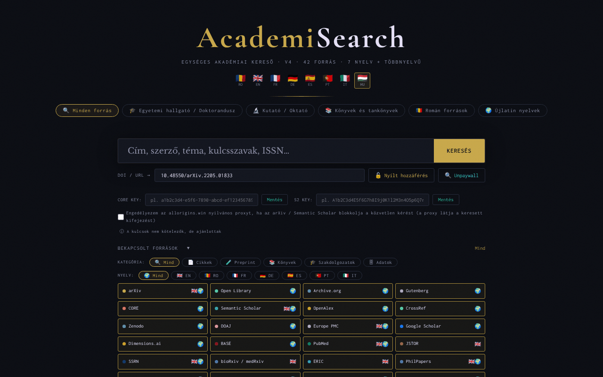

# AcademiSearch

[English](README.md) · [Română](README.ro.md) · [Français](README.fr.md) · [Italiano](README.it.md) · [Español](README.es.md) · [Português](README.pt.md) · [Deutsch](README.de.md) · **Magyar**

**Verzió:** 4.3.10 · **Utolsó frissítés:** 2026-10-22

A felület nyelvei: **Română, English, Français, Italiano, Español, Português (PT), Deutsch, Magyar**

Egységes tudományos keresőmotor egyetlen HTML-fájlban: 42 nyílt hozzáférésű forrás, 8 felületi nyelv.

**Online alkalmazás:** https://chiuta.github.io/AcademiSearch/

## Mi ez

Az AcademiSearch egyetlen `index.html` fájlban lévő alkalmazás, amely egyszerre több tudományos forrást kérdez le (cikkek, preprintek, könyvek, értekezések, kutatási adatok), és az eredményeket egy közös ablakban jeleníti meg. A források egy részénél az eredményeket közvetlenül API-n keresztül hozza le; a többinél az alkalmazás közvetlen hivatkozást ad az adott portál keresőoldalára. Az alkalmazásban szereplő szöveg szerint 42 forrás van: 11 élő eredménnyel API-n keresztül és 31 portál közvetlen hivatkozással.

## Funkciók

- Felület 8 nyelven: román, angol, francia, német, spanyol, portugál, olasz, magyar (RO / EN / FR / DE / ES / PT / IT / HU gombok).
- Keresési előbeállítások: „Minden forrás”, „Egyetemi hallgató / Doktorandusz”, „Kutató / Oktató”, „Könyvek és tankönyvek”, „Román források”, „Újlatin nyelvek”.
- Egy „Bekapcsolt források” panel a források egyenkénti bejelölésével.
- Szűrők kategória (Cikkek, Preprint, Könyvek, Értekezések, Adatok) és nyelv (EN, RO, FR, DE, ES, PT, IT) szerint.
- Eredmények „PDF-fel” és „DOI-val” szűrőkkel és az eredmények fokozatos betöltésével.
- Egy „DOI / URL” mező a „Szabad hozzáférés” és az „Unpaywall” gombokkal: az alkalmazás nyílt hozzáférésű változatot keres a CrossRefen (ha hiányzik a DOI), az Unpaywallon, az OpenAIRE-en és egy címalapú kereséssel az Unpaywallban.
- Opcionális mezők egy CORE API-kulcshoz és egy Semantic Scholar API-kulcshoz.
- A szűrt eredmények exportálása BibTeX, RIS vagy CSV formátumban (helyben, a böngészőben generált fájl, hálózati kérések nélkül). A szerzők listáját úgy exportálja, ahogy a forrás visszaadja (egyes források csonkolják a listát), a `=`, `+`, `-` vagy `@` karakterrel kezdődő CSV-mezők pedig semlegesítve vannak.
- A „DOI / URL” mező megtisztítja az előtagokat (`doi:`, `https://doi.org/`), és világos üzenetet jelenít meg, ha a DOI formátuma érvénytelen.
- A `/` billentyű a keresőmezőre viszi a fókuszt; az aktuális munkamenet keresései javaslatként jelennek meg (semmi nem kerül mentésre).
- Egy „Jogi feltételek és GDPR” ablak, a felület nyelvén megjelenítve: a román szöveg az eredeti; a többi 7 nyelvre készült fordítások (11 szakasz) gépiek, nem adnak hozzá záradékokat, és **jogi szakértői felülvizsgálatot igényelnek**.
- A 42 forrás leírásai (chipek, súgószövegek, szakaszcímek és portálkártyák) mind a 8 nyelven elérhetők; az RO-tól és EN-től eltérő fordítások gépiek, és anyanyelvi beszélők nem ellenőrizték őket.

## Új funkciók (4.1.0)

- **Relevancia szerinti rendezés** az eredményablakban a szűrt eredményekre: helyi keresés (BM25, elírástűrés, a diakritikus jelek figyelmen kívül hagyása) a már lehozott címek és kivonatok felett; a régi szó szerinti illesztés megmarad. Nem küld hálózati kérést.
- **„Könyvtáram”**: mentés/eltávolítás gombok minden kártyán; egy ablak a könyvtárban való kereséssel, BibTeX / RIS / CSV exporttal és kétlépéses törléssel. Legfeljebb 500 rekord, kizárólag ebben a böngészőben tárolva.
- `.fff.json` biztonsági másolat (a közös „fff-kit” modul, helyi, hálózat nélkül): a láblécben a verzióra kattintva megjelenő párbeszédablakból nyílik meg (export, jelszóval titkosított export, importálás megerősítéssel, az alkalmazás adatainak törlése). A másolat tartalmazza a könyvtárat és a felület nyelvét.
- A könyvtár új szövegei románul, angolul, franciául, németül, spanyolul, portugálul, olaszul és magyarul vannak; **a fordításokat anyanyelvi beszélők nem ellenőrizték.**

## Használati útmutató

1. Nyisd meg az oldalt, és válaszd ki a felület nyelvét a felső sarokban (RO, EN, FR, DE, ES, PT, IT, HU).
2. Válassz egy előbeállítást (például „Egyetemi hallgató / Doktorandusz”), vagy nyisd meg a „Bekapcsolt források” panelt, és jelöld be kézzel a kívánt forrásokat.
3. Szükség esetén szűkíts KATEGÓRIA és NYELV szerint.
4. Írd be a kifejezést a keresőmezőbe, és nyomd meg az Entert vagy a „KERESÉS” gombot.
5. Az eredményablakban használd a „PDF-fel” / „DOI-val” szűrőket; zárd be a „Bezárás” gombbal vagy az Escape billentyűvel.
6. Ismert cikk esetén illeszd be a DOI-t vagy az URL-t a „DOI / URL” mezőbe, és nyomd meg a „Szabad hozzáférés” (vagy az „Unpaywall”) gombot.
7. A CORE-hoz és a Semantic Scholarhoz megadhatod az API-kulcsot, és megnyomhatod a „Mentés” gombot (a kulcsok opcionálisak).

## Adatvédelem és hálózat

- Helyi: a felület nyelve a `localStorage`-ban marad (`ui_lang`); a személyes könyvtár a `localStorage`-ban (`as_library`, legfeljebb 500 rekord, nem hagyja el a böngészőt); a megadott API-kulcsok a `sessionStorage`-ban maradnak, és a lap bezárásakor eltűnnek. Az alkalmazás nem használ sütiket.
- Hálózat: az alkalmazás NEM offline. Minden keresésnél a keresett kifejezés közvetlenül a böngészőből kerül elküldésre az aktív külső szolgáltatásoknak: OpenAlex, CrossRef, CORE, Semantic Scholar, arXiv, Europe PMC (ebi.ac.uk), DOAJ, Zenodo, Open Library, Internet Archive, Project Gutenberg (gutendex.com). A „Szabad hozzáférés” / „Unpaywall” használatakor a CrossRef, az Unpaywall és az OpenAIRE kerül megkeresésre.
- CORS-proxy (opt-in, alapértelmezés szerint kikapcsolva): az arXiv és a Semantic Scholar lekérdezése közvetlenül történik. Csak ha kifejezetten bejelölöd az „Az allorigins.win nyilvános proxy engedélyezése” opciót (az API-kulcsmezők mellett; a lap időtartamára érvényes), és a böngésző blokkolja a közvetlen kérést (CORS), az adott kérés az `api.allorigins.win` címen keresztül kerül újraküldésre, amely láthatja a lekérdezés URL-jét (a keresett kifejezést). Az API-kulcsok soha nem haladnak át a proxyn.
- Az OpenAlex és az Unpaywall felé küldött kérések tartalmazzák az üzemeltető kapcsolati címét (`academisearch@alexio.tf`), a „polite pool” konvenciónak megfelelően.
- A közvetlen hivatkozású portálok csak akkor kerülnek megkeresésre, ha megnyitod a hivatkozást.
- Betűtípusok/CDN: az auditon ellenőrizve (2026-10-10): nincs CDN-ről betöltött szkript, betűtípus vagy stílus; a betűtípusok be vannak építve, és az oldal CSP-szabályzata (`connect-src`; `script-src` ellenőrzőösszeggel, `unsafe-inline` nélkül) a kéréseket a fenti hosztokra korlátozza.

## Helyi futtatás / offline

Töltsd le az `index.html` fájlt, és nyisd meg böngészőben. A felület helyben elindul, de a kereséshez internetkapcsolat szükséges.

## Előzmények / Változásnapló

### 4.3.10 — 2026-10-22
- fff-kit 1.1.4: érintési célpontok és minimális szövegméret

### 4.3.9 — 2026-10-22
- Akadálymentesség: jól látható fókuszkeret a fő keresőmezőn, valamint a DOI-, API-kulcs-, könyvtár- és belső keresőmezőkön (legalább 3:1 kontraszt).

### 4.3.8 — 2026-10-22
- Érintési célpontok: a lábléc „Könyvtáram” gombja mostantól legalább 28 px magas (CSS-specificitás javítva).

### 4.3.7 — 2026-10-22
- fff-kit 1.1.2: PBKDF2 600 000 iteráció, clickjacking elleni védelem

### 4.3.6 — 2026-10-22
- Forrásonkénti állapot az eredményablakban: minden API-forrás OK / kérési korlát / időtúllépés / blokkolva-CORS állapotot mutat, látható „A sikertelen források újrapróbálása” gombbal és visszalépéssel (2 mp, 4 mp…).
- Memóriabeli munkamenet-gyorsítótár forrásonként és lekérdezésenként (kevesebb 429-es hiba ismételt keresésnél).
- Mobil: nincs 12 px alatti szöveg, az érintési célpontok legalább 24 px-esek (WCAG 2.5.8).

### 4.3.5 — 2026-10-22
- Fordítási javítás: az átláthatósági panel leírása (és neve) mostantól a felület nyelvét követi.

### 4.3.4 — 2026-10-22
- Az oldal címe, a „Keresés…” számláló és a könyvtári keresés aria-label értéke mostantól a felület nyelvét követi.

### 2026. október 19. (v4.3.1–4.3.3)
- A 42 forrás leírásai és a „Jogi feltételek és GDPR” ablak mind a 8 nyelvre le van fordítva (a román jogi szöveg marad az eredeti; a fordítások jogi felülvizsgálatot igényelnek).
- Javítva: a „Könyvtáram” párbeszédablaknak nem voltak témaszínei (a szöveg olvashatatlan volt a sötét témán); most a téma változóit használja.

### 2026. október 18. (v4.2.0)
- Új: `#q=<kifejezés>` belépő hivatkozás (pl. a Nota Zero-ból), amely csak előre kitölti a keresőmezőt; a keresés nem indul el magától, és a töredék olvasás után törlődik a címből.

### 2026. október 18. (v4.1.1)
- Források, amelyek már nem maradnak pirosak/blokkoltak: az arXiv (CORS nélkül) automatikusan átvált az OpenAlex arXiv-preprintjeire; a kulcs nélküli CORE az OpenAIRE-re, majd az OpenAlex OA-adattáraira vált; a Semantic Scholar egy 429 után újra próbálkozik, majd az OpenAlexre vált; a Gutenberg 8 s időkorláttal és az Archive.org Gutenberg-gyűjteményére való visszalépéssel rendelkezik.
- Minden forrásnak 30 s időkorlátja van, és a hiba oka eszköztippként jelenik meg a piros csipen.

### 2026. október 14. (v4.1.0)
- Helyi relevancia szerinti rendezés az eredményablakban (FFF.search).
- „Könyvtáram” (a `localStorage` `as_library` kulcsa) kereséssel és BibTeX/RIS/CSV exporttal.
- `.fff.json` biztonsági másolat a közös modulokon keresztül (core, label, bundle, search); a verzió a láblécben jelenik meg.
- Új tesztek: `tests/fff-r8.test.mjs`.

### 2026. október 12. (v4.0.4)
- 4.0.4 — 2026-10-12: a verzió és az utolsó frissítés dátuma megjelenik az alkalmazásban

### 2026. október 11. (v4.0.3)
- Javítva a 360 px-es képernyőkön levágott KERESÉS gomb, és megnövelve a kis érintési célpontok (gombok, szűrők, jelölőnégyzetek).
- A „/” billentyű a keresőmezőre viszi a fókuszt; az aktuális munkamenet keresései javaslatként jelennek meg (csak a memóriában, nem kerülnek mentésre).

### 2026. október 11. (v4.0.3)
- Biztonság: mind a 34 beágyazott `on*` attribútum le lett cserélve egy delegált diszpécserre (`data-act` + egyetlen figyelő); a CSP-szabályzat mostantól ellenőrzőösszeges `script-src`-et használ, a szkriptekhez `'unsafe-inline'` nélkül.
- A szűrt eredmények BibTeX / RIS / CSV exportja; üzenetek mind a 7 nyelven.
- A DOI-mező ellenőrzése és tisztítása hozzáférhető hibaüzenettel (`role="status"`).

### 2026. október 11. (v4.0.1)
- Hozzáférhetőség: a tartalom <main> elembe van foglalva, a források mostantól érvényes `checkbox` szerepű elemek (axe: 0 szabálysértés).
- Szerzői jogi figyelmeztetés hozzáadva a 101books.club és a Scribd Downloader forráshoz (leírás/eszköztipp), egyértelművé téve, hogy nem nyílt hozzáférésű források.
- A „Jogi feltételek” ablakban szereplő verzió és a frissítés dátuma: 4.0.1, 2026. október 11.

## Licenc

MIT — lásd a LICENSE fájlt

## Szerző

Alexio — Alexandru-Ionuț Chiuță, kapcsolat: alexio@trom.tf

## Összefoglaló

Az AcademiSearch egy egyfájlos HTML metakereső eszköz 42 nyílt hozzáférésű tudományos forráshoz (11 élő API-eredménnyel, 31 közvetlen hivatkozású portálként), 8 nyelvű felülettel. Nem offline: a keresések közvetlenül a böngészőből mennek harmadik felek API-jaihoz, és az arXiv/Semantic Scholar csak akkor használhatja az allorigins.win CORS-proxyt, ha kifejezetten bejelölsz egy opt-in jelölőnégyzetet (alapértelmezés szerint kikapcsolva). Csak a felület nyelve (localStorage) és az opcionális API-kulcsok (sessionStorage) kerülnek tárolásra. MIT licenc. A szűrt eredmények exportálhatók BibTeX, RIS vagy CSV formátumban (helyben generálva).

2. forduló auditja (2026-10-11): az allorigins.win proxy opt-in lett. Audit: 2026-10-10 — ellenőrizve a kód (hálózati kérések, az API-eredmények escape-elése, CORS-proxy: az API-kulcsok csak a közvetlen fejlécben kerülnek elküldésre, soha nem a proxyn keresztül), a hozzáférhetőség (axe) és a működés (offline keresés: a forráshibák kezelve). A „42 forrás” szám egyezik: 11 API + 31 portál.
