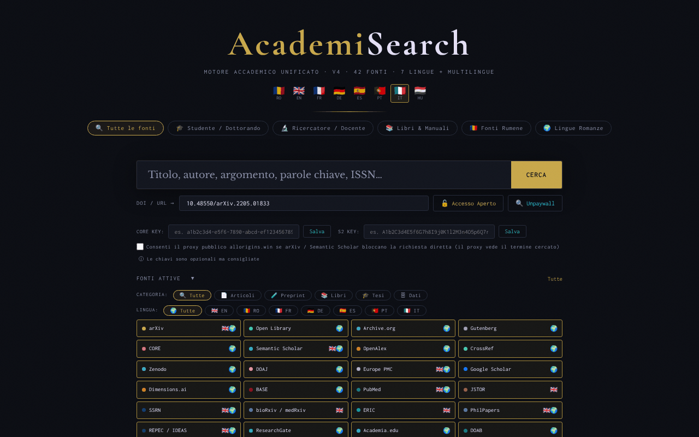

# AcademiSearch

[English](README.md) · [Română](README.ro.md) · [Français](README.fr.md) · **Italiano** · [Español](README.es.md) · [Português](README.pt.md) · [Deutsch](README.de.md) · [Magyar](README.hu.md)

**Versione:** 4.3.2 · **Ultimo aggiornamento:** 2026-10-19

Lingue dell'interfaccia: **Română, English, Français, Italiano, Español, Português (PT), Deutsch, Magyar**

Un motore di ricerca accademico unificato in un unico file HTML: 42 fonti ad accesso aperto, 8 lingue di interfaccia.

**Applicazione online:** https://chiuta.github.io/AcademiSearch/

## Che cos'è

AcademiSearch è un'applicazione contenuta in un unico file `index.html` che interroga contemporaneamente più fonti accademiche (articoli, preprint, libri, tesi, dati di ricerca) e mostra i risultati in una finestra comune. Per una parte delle fonti i risultati vengono recuperati direttamente tramite API; per le altre l'applicazione offre un link diretto alla pagina di ricerca del portale in questione. Secondo il testo nell'applicazione, le fonti sono 42: 11 con risultati in tempo reale tramite API e 31 portali con link diretto.

## Funzioni

- Interfaccia in 8 lingue: rumeno, inglese, francese, tedesco, spagnolo, portoghese, italiano (pulsanti RO / EN / FR / DE / ES / PT / IT / HU).
- Preimpostazioni di ricerca: «Tutte le fonti», «Studente / Dottorando», «Ricercatore / Docente», «Libri & Manuali», «Fonti romene», «Lingue romanze».
- Un pannello «Fonti attivate» con selezione individuale delle fonti.
- Filtri per categoria (Articoli, Preprint, Libri, Tesi, Dati) e per lingua (EN, RO, FR, DE, ES, PT, IT).
- Risultati con i filtri «Con PDF» e «Con DOI» e caricamento progressivo dei risultati.
- Un campo «DOI / URL» con i pulsanti «Accesso libero» e «Unpaywall»: l'applicazione cerca una versione ad accesso aperto tramite CrossRef (se manca il DOI), Unpaywall, OpenAIRE e una ricerca per titolo in Unpaywall.
- Campi facoltativi per una chiave API CORE e una chiave API Semantic Scholar.
- Esportazione dei risultati filtrati in BibTeX, RIS o CSV (file generato localmente nel browser, senza richieste di rete). L'elenco degli autori viene esportato così come lo restituisce la fonte (alcune fonti troncano l'elenco), e i campi CSV che iniziano con `=`, `+`, `-` o `@` vengono neutralizzati.
- Il campo «DOI / URL» ripulisce i prefissi (`doi:`, `https://doi.org/`) e mostra un messaggio chiaro quando il formato del DOI non è valido.
- Il tasto `/` sposta il focus nel campo di ricerca; le ricerche della sessione corrente vengono suggerite (non viene salvato nulla).
- Una finestra «Termini legali & GDPR».

## Nuove funzioni (4.1.0)

- **Ordinamento per rilevanza** dei risultati filtrati nella finestra dei risultati: ricerca locale (BM25, tolleranza agli errori di battitura, segni diacritici ignorati) su titoli e riassunti già recuperati; la vecchia corrispondenza letterale resta. Non effettua alcuna richiesta di rete.
- **«La mia biblioteca»**: pulsanti di salvataggio/rimozione su ogni scheda; una finestra con ricerca nella biblioteca, esportazione BibTeX / RIS / CSV ed eliminazione in due passaggi. Al massimo 500 record, conservati solo in questo browser.
- Copia di riserva `.fff.json` (modulo comune «fff-kit», locale, senza rete): si apre dalla finestra di dialogo che compare facendo clic sulla versione nel piè di pagina (esportazione, esportazione cifrata con password, importazione con conferma, cancellazione dei dati dell'applicazione). La copia comprende la biblioteca e la lingua dell'interfaccia.
- I nuovi testi della biblioteca sono in rumeno, inglese, francese, tedesco, spagnolo, portoghese e italiano; **le traduzioni non sono state verificate da madrelingua.**

## Guida all'uso

1. Apri la pagina e scegli la lingua dell'interfaccia dall'angolo in alto (RO, EN, FR, DE, ES, PT, IT, HU).
2. Scegli una preimpostazione (ad esempio «Studente / Dottorando») oppure apri «Fonti attivate» e seleziona manualmente le fonti desiderate.
3. Facoltativamente, restringi per CATEGORIA e LINGUA.
4. Scrivi il termine nel campo di ricerca e premi Invio o il pulsante «CERCA».
5. Nella finestra dei risultati usa i filtri «Con PDF» / «Con DOI»; chiudi con «Chiudi» o il tasto Esc.
6. Per un articolo noto, incolla il DOI o l'URL nel campo «DOI / URL» e premi «Accesso libero» (o «Unpaywall»).
7. Per CORE e Semantic Scholar puoi inserire la chiave API e premere «Salva» (le chiavi sono facoltative).

## Riservatezza e rete

- Locale: la lingua dell'interfaccia viene conservata in `localStorage` (`ui_lang`); la biblioteca personale, in `localStorage` (`as_library`, al massimo 500 record, non lascia il browser); le chiavi API inserite vengono conservate in `sessionStorage` e scompaiono alla chiusura della scheda. L'applicazione non usa cookie.
- Rete: l'applicazione NON è offline. A ogni ricerca, il termine cercato viene inviato ai servizi esterni attivi, direttamente dal browser: OpenAlex, CrossRef, CORE, Semantic Scholar, arXiv, Europe PMC (ebi.ac.uk), DOAJ, Zenodo, Open Library, Internet Archive, Project Gutenberg (gutendex.com). Con «Accesso libero» / «Unpaywall» vengono contattati CrossRef, Unpaywall e OpenAIRE.
- Proxy CORS (opt-in, disattivato per impostazione predefinita): arXiv e Semantic Scholar vengono interrogati direttamente. Solo se selezioni esplicitamente «Consenti il proxy pubblico allorigins.win» (accanto ai campi per le chiavi API; valido per la durata della scheda) e il browser blocca la richiesta diretta (CORS), quella richiesta viene rinviata tramite `api.allorigins.win`, che può vedere l'URL dell'interrogazione (il termine cercato). Le chiavi API non passano mai attraverso il proxy.
- Le richieste a OpenAlex e Unpaywall includono l'indirizzo di contatto dell'operatore (`academisearch@alexio.tf`), secondo la convenzione del «polite pool».
- I portali con link diretto vengono contattati solo se apri il link.
- Font/CDN: verificato all'audit (2026-10-10): non ci sono script, font o stili caricati da una CDN; i font sono integrati, e la politica CSP della pagina (`connect-src`; `script-src` con hash, senza `unsafe-inline`) limita le richieste agli host sopra indicati.

## Esecuzione locale / offline

Scarica `index.html` e aprilo in un browser. L'interfaccia si avvia in locale, ma la ricerca richiede una connessione a internet.

## Cronologia / Changelog

### 18 ottobre 2026 (v4.2.0)
- Novità: link di ingresso `#q=<termine>` (ad es. da Nota Zero) che si limita a precompilare il campo di ricerca; la ricerca non parte da sola e il frammento viene rimosso dall'indirizzo dopo la lettura.

### 18 ottobre 2026 (v4.1.1)
- Fonti che non restano più rosse/bloccate: arXiv (senza CORS) passa automaticamente ai preprint arXiv di OpenAlex; CORE senza chiave passa a OpenAIRE, poi ai repository OA di OpenAlex; Semantic Scholar riprova dopo un 429 e poi passa a OpenAlex; Gutenberg ha un timeout di 8 s e un ripiego sulla collezione Gutenberg di Archive.org.
- Ogni fonte ha un timeout di 30 s e il motivo dell'errore compare come tooltip sul chip rosso.

### 14 ottobre 2026 (v4.1.0)
- Ordinamento locale per rilevanza nella finestra dei risultati (FFF.search).
- «La mia biblioteca» (chiave `localStorage` `as_library`) con ricerca ed esportazione BibTeX/RIS/CSV.
- Copia di riserva `.fff.json` tramite i moduli comuni (core, label, bundle, search); versione mostrata nel piè di pagina.
- Nuovi test: `tests/fff-r8.test.mjs`.

### 12 ottobre 2026 (v4.0.4)
- 4.0.4 — 2026-10-12: la versione e la data dell'ultimo aggiornamento sono mostrate nell'applicazione

### 11 ottobre 2026 (v4.0.3)
- Corretto il pulsante CERCA tagliato sugli schermi da 360 px e ingranditi i piccoli bersagli tattili (pulsanti, filtri, caselle).
- Il tasto «/» sposta il focus nel campo di ricerca; le ricerche della sessione corrente compaiono come suggerimenti (solo in memoria, non vengono salvate).

### 11 ottobre 2026 (v4.0.3)
- Sicurezza: tutti i 34 attributi `on*` inline sono stati sostituiti da un dispatcher delegato (`data-act` + un unico listener); la politica CSP usa ora `script-src` con hash, senza `'unsafe-inline'` per gli script.
- Esportazione BibTeX / RIS / CSV dei risultati filtrati; messaggi in tutte e 7 le lingue.
- Validazione e pulizia del campo DOI, con un messaggio di errore accessibile (`role="status"`).

### 11 ottobre 2026 (v4.0.1)
- Accessibilità: il contenuto è racchiuso in <main>, le fonti sono ora elementi con un ruolo `checkbox` valido (axe: 0 violazioni).
- Avviso sul diritto d'autore aggiunto alle fonti 101books.club e Scribd Downloader (descrizione/tooltip), con la precisazione che non sono fonti ad accesso aperto.
- La versione nella finestra «Termini legali» e la data di aggiornamento: 4.0.1, 11 ottobre 2026.

## Licenza

MIT — vedi il file LICENSE

## Autore

Alexio — Alexandru-Ionuț Chiuță, contatto: alexio@trom.tf

## Riepilogo

AcademiSearch è un meta-motore di ricerca HTML in un unico file su 42 fonti accademiche ad accesso aperto (11 con risultati in tempo reale tramite API, 31 come portali con link diretto), con interfaccia in 8 lingue. Non è offline: le ricerche vanno direttamente dal browser alle API di terzi, e arXiv/Semantic Scholar possono usare il proxy CORS allorigins.win solo se selezioni esplicitamente una casella opt-in (disattivata per impostazione predefinita). Vengono conservati solo la lingua dell'interfaccia (localStorage) e le eventuali chiavi API (sessionStorage). Licenza MIT. I risultati filtrati possono essere esportati in BibTeX, RIS o CSV (generati localmente).

Audit del round 2 (2026-10-11): il proxy allorigins.win è diventato opt-in. Audit: 2026-10-10 — verificato il codice (richieste di rete, escape dei risultati delle API, proxy CORS: le chiavi API vengono inviate solo nell'intestazione diretta, mai attraverso il proxy), l'accessibilità (axe) e il funzionamento (ricerca offline: errori delle fonti gestiti). Il numero «42 fonti» corrisponde: 11 API + 31 portali.
