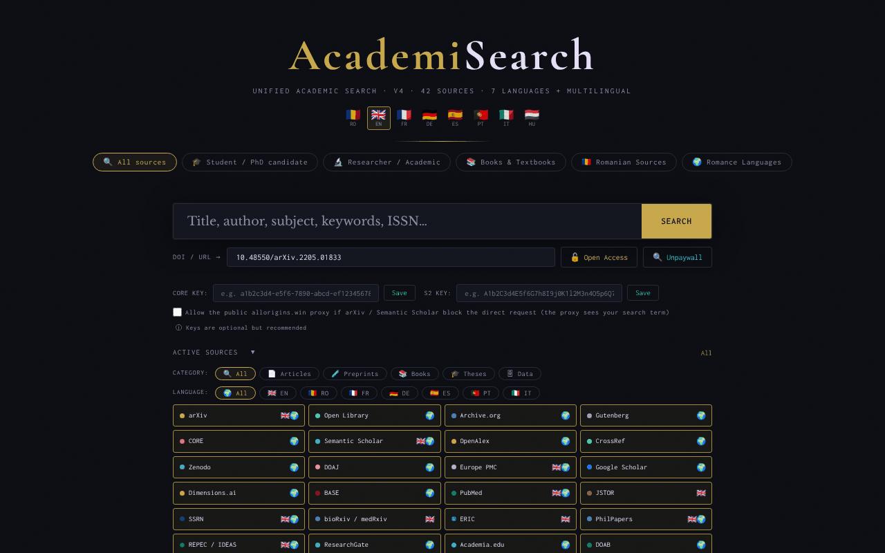

# AcademiSearch

**English** · [Română](README.ro.md) · [Français](README.fr.md) · [Italiano](README.it.md) · [Español](README.es.md) · [Português](README.pt.md) · [Deutsch](README.de.md) · [Magyar](README.hu.md)

**Version:** 5.1.0 · **Last updated:** 2026-10-27

**Status:** stable · **Offline:** needs internet for search (source APIs)

Interface languages: **Română, English, Français, Italiano, Español, Português (PT), Deutsch, Magyar**

A unified academic search engine in a single HTML file: 42 open-access sources, 8 interface languages.

**Live app:** https://chiuta.github.io/AcademiSearch/

## What it is

AcademiSearch is an application in a single `index.html` file that queries several academic sources at once (articles, preprints, books, theses, research data) and shows the results in a common window. For some of the sources the results are fetched directly through an API; for the rest the app offers a direct link to that portal's search page. According to the text in the app, there are 42 sources: 11 with live results through an API and 31 portals with a direct link.

## Features

- Interface in 8 languages: Romanian, English, French, German, Spanish, Portuguese, Italian, Hungarian (RO / EN / FR / DE / ES / PT / IT / HU buttons).
- Search presets: "All sources", "Student / Doctoral candidate", "Researcher / Teaching staff", "Books & Textbooks", "Romanian Sources", "Romance Languages".
- An "Enabled sources" panel with individual ticking of the sources.
- Filters by category (Articles, Preprint, Books, Theses, Data) and by language (EN, RO, FR, DE, ES, PT, IT).
- Results with "With PDF" and "With DOI" filters and progressive loading of results.
- A "DOI / URL" field with the "Open Access" and "Unpaywall" buttons: the app looks for an open-access version through CrossRef (if the DOI is missing), Unpaywall, OpenAIRE and a title search in Unpaywall.
- Optional fields for a CORE API key and a Semantic Scholar API key.
- Export of the filtered results to BibTeX, RIS or CSV (a file generated locally in the browser, with no network requests). The author list is exported as the source returns it (some sources truncate the list), and CSV fields that begin with `=`, `+`, `-` or `@` are neutralised.
- The "DOI / URL" field cleans the prefixes (`doi:`, `https://doi.org/`) and displays a clear message when the DOI format is invalid.
- The `/` key moves focus to the search field; the searches of the current session are suggested (nothing is saved).
- A "Legal terms & GDPR" window, shown in the interface language: the Romanian text is the original; the translations into the other 7 languages (11 sections) are automatic, add no clauses and **need review by a legal specialist**.
- The descriptions of the 42 sources (chips, tooltips, section headings and portal cards) are available in all 8 languages; the translations other than RO and EN are automatic and have not been verified by native speakers.
- **Zotero (5.1.0):** a "Zotero" button (results and library) downloads the list as RIS, which Zotero imports (File → Import…). Each result card also carries invisible COinS metadata (`Z3988`), so the Zotero Connector can recognise the items on the page. Local, no network. A direct push to a running Zotero is *planned* (it needs a test against a real Zotero and is not included).
- **Free PDFs in bulk (5.1.0):** the "Free PDFs (Unpaywall)" button looks up, on request, up to 25 filtered results that have a DOI but no PDF (3 requests at a time) and attaches only a real `url_for_pdf` from Unpaywall. This sends those DOIs to `api.unpaywall.org` (already in the list of hosts above); nothing is sent unless you press the button.

## New features (4.1.0)

- **Sorting by relevance** of the filtered results in the results window: local search (BM25, tolerance for typos, diacritics ignored) over the titles and abstracts already fetched; the old literal matching remains. It makes no network requests.
- **"My library"**: save/remove buttons on each card; a window with search in the library, BibTeX / RIS / CSV export and two-step deletion. At most 500 records, kept only in this browser.
- `.fff.json` backup copy (the common "fff-kit" module, local, no network): it opens from the dialog that appears when you click the version in the footer (export, password-encrypted export, import with confirmation, deletion of the app's data). The copy includes the library and the interface language.
- The new library texts are in Romanian, English, French, German, Spanish, Portuguese, Italian and Hungarian; **the translations have not been verified by native speakers.**

## User guide

1. Open the page and choose the interface language from the top corner (RO, EN, FR, DE, ES, PT, IT, HU).
2. Choose a preset (for example "Student / Doctoral candidate") or open "Enabled sources" and tick the sources you want manually.
3. Optionally, narrow down by CATEGORY and LANGUAGE.
4. Type the term in the search field and press Enter or the "SEARCH" button.
5. In the results window use the "With PDF" / "With DOI" filters; close with "Close" or the Escape key.
6. For a known article, paste the DOI or URL in the "DOI / URL" field and press "Open Access" (or "Unpaywall").
7. For CORE and Semantic Scholar you can enter the API key and press "Save" (the keys are optional).

## Privacy and network

- Local: the interface language is kept in `localStorage` (`academisearch.lang`); the personal library in `localStorage` (`academisearch.library`, at most 500 records, it does not leave the browser); the API keys entered are kept in `sessionStorage` and disappear when the tab is closed. The app does not use cookies.
- Network: the app is NOT offline. With every search, the searched term is sent to the active external services, directly from the browser: OpenAlex, CrossRef, CORE, Semantic Scholar, arXiv, Europe PMC (ebi.ac.uk), DOAJ, Zenodo, Open Library, Internet Archive, Project Gutenberg (gutendex.com). With "Open Access" / "Unpaywall", CrossRef, Unpaywall and OpenAIRE are contacted.
- CORS proxy (opt-in, off by default): arXiv and Semantic Scholar are queried directly. Only if you explicitly tick "Allow the public proxy allorigins.win" (next to the API key fields; valid for the duration of the tab) and the browser blocks the direct request (CORS), that request is resent through `api.allorigins.win`, which can see the query URL (the searched term). The API keys never pass through the proxy.
- Requests to OpenAlex and Unpaywall include the operator's contact address (`academisearch@alexio.tf`), following the "polite pool" convention.
- The portals with a direct link are contacted only if you open the link.
- Fonts/CDN: verified at the audit (2026-10-10): there are no scripts, fonts or styles loaded from a CDN; the fonts are built in, and the page's CSP policy (`connect-src`; `script-src` with a hash, no `unsafe-inline`) limits requests to the hosts above.

## Running locally / offline

Download `index.html` and open it in a browser. The interface starts locally, but searching requires an internet connection.

## History / Changelog

### 5.1.0 — 2026-10-27
- Zotero export (RIS) and invisible COinS metadata on the cards for the Zotero Connector.
- "Free PDFs (Unpaywall)" button: bulk lookup (max. 25, on request) for results with a DOI and no PDF.
- Already present since 5.0.0 (the review asked for them): cross-source deduplication by DOI, Unpaywall button per card.
- Not done: direct push to a running Zotero (needs testing against a real Zotero).
- New test: `tests/zotero-oa.test.mjs`.

### 5.0.0 — 2026-10-26

- **Research folders** in My library: create folders (max 30), move references between them, add a personal note to each; new saves go into the active folder. Export a folder as BibTeX/RIS/CSV or **Markdown** (with notes). Stored locally.
- **Cross-source deduplication**: the same work returned by several APIs is shown once (by DOI or, without DOI, title + year + first author); missing PDF/abstract/DOI are filled in from the other sources and the card shows where else it was found.
- **Citation network** (OpenAlex, on request): graph of references and citing works with lists, totals and one-click save to the library. OpenAlex coverage is incomplete, and the UI says so.

### 4.3.12 — 2026-10-23
- Storage keys now carry the app prefix (`academisearch.lang`, `academisearch.library`); existing data (language, saved library) is migrated automatically at startup, and old `.fff.json` copies can still be imported.
- fff-kit 1.2.0: unprefixed-storage fixed

### 4.3.10 — 2026-10-22
- fff-kit 1.1.4: touch targets and minimum text size

### 4.3.9 — 2026-10-22
- Accessibility: clear focus ring on the main search field and on the DOI, API-key, library and internal-search fields (contrast of at least 3:1).

### 4.3.8 — 2026-10-22
- Touch targets: the footer “My library” button is now at least 28 px tall (CSS specificity fix).

### 4.3.7 — 2026-10-22
- fff-kit 1.1.2: PBKDF2 600,000 iterations, anti-clickjacking protection

### 4.3.6 — 2026-10-22
- Per-source status in the results window: each API source shows OK, rate limit, timeout or blocked/CORS, plus a visible "Retry failed sources" button with backoff (2 s, 4 s…).
- In-memory session cache of results per source and query (fewer 429 errors on repeated searches).
- Mobile: no text below 12 px and touch targets of at least 24 px (WCAG 2.5.8).

### 4.3.5 — 2026-10-22
- Translation fix: the description (and name) in the transparency panel now follow the interface language.

### 4.3.4 — 2026-10-22
- The page title, the "Searching…" counter and the library search aria-label now follow the interface language.

### 19 October 2026 (v4.3.1–4.3.3)
- The descriptions of the 42 sources and the "Legal terms & GDPR" window are translated into all 8 languages (the Romanian legal text remains the original; the translations need legal review).
- Fixed: the "My library" dialog had no theme colours (text unreadable on the dark theme); it now uses the theme variables.

### 18 October 2026 (v4.2.0)
- New: an entry link `#q=<term>` (e.g. from Nota Zero) that only pre-fills the search field; the search does not start by itself, and the fragment is removed from the address after reading.

### 18 October 2026 (v4.1.1)
- Sources that no longer stay red/blocked: arXiv (without CORS) automatically switches to the arXiv preprints in OpenAlex; CORE without a key switches to OpenAIRE, then to the OA repositories in OpenAlex; Semantic Scholar retries after a 429 and then switches to OpenAlex; Gutenberg has an 8 s timeout and a fallback to the Gutenberg collection on Archive.org.
- Each source has a 30 s timeout, and the reason for the error appears as a tooltip on the red chip.

### 14 October 2026 (v4.1.0)
- Local sorting by relevance in the results window (FFF.search).
- "My library" (the `localStorage` key `academisearch.library`) with search and BibTeX/RIS/CSV export.
- `.fff.json` backup copy through the common modules (core, label, bundle, search); the version shown in the footer.
- New tests: `tests/fff-r8.test.mjs`.

### 12 October 2026 (v4.0.4)
- 4.0.4 — 2026-10-12: the version and the date of the last update are shown in the app

### 11 October 2026 (v4.0.3)
- Fixed the SEARCH button being cut off on 360 px screens and enlarged the small touch targets (buttons, filters, boxes).
- The "/" key moves focus to the search field; the searches of the current session appear as suggestions (in memory only, not saved).

### 11 October 2026 (v4.0.3)
- Security: all 34 inline `on*` attributes were replaced with a delegated dispatcher (`data-act` + a single listener); the CSP policy now uses `script-src` with a hash, without `'unsafe-inline'` for scripts.
- BibTeX / RIS / CSV export of the filtered results; messages in all 7 languages.
- Validation and cleaning of the DOI field, with an accessible error message (`role="status"`).

### 11 October 2026 (v4.0.1)
- Accessibility: the content is wrapped in <main>, the sources are now elements with a valid `checkbox` role (axe: 0 violations).
- Copyright warning added to the 101books.club and Scribd Downloader sources (description/tooltip), making clear that they are not open-access sources.
- The version in the "Legal terms" window and the update date: 4.0.1, 11 October 2026.

## Licence

MIT — see the LICENSE file

## Author

Alexio — Alexandru-Ionuț Chiuță, contact: alexio@trom.tf

## Summary

AcademiSearch is a single-file HTML meta-search tool over 42 open-access academic sources (11 with live API results, 31 as direct-link portals), with an 8-language UI. It is not offline: searches go directly from the browser to third-party APIs, and arXiv/Semantic Scholar can use the allorigins.win CORS proxy only if you explicitly tick an opt-in checkbox (off by default). Only the UI language (localStorage) and optional API keys (sessionStorage) are stored. MIT licence. Filtered results can be exported as BibTeX, RIS or CSV (generated locally).

Round 2 audit (2026-10-11): the allorigins.win proxy became opt-in. Audit: 2026-10-10 — verified the code (network requests, escaping of API results, CORS proxy: API keys are sent only in the direct header, never through the proxy), accessibility (axe) and operation (offline search: source errors handled). The figure "42 sources" matches: 11 API + 31 portals.
