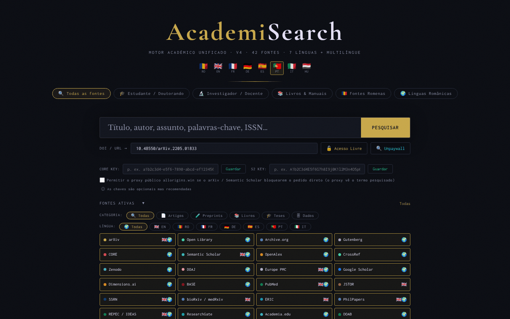

# AcademiSearch

[English](README.md) · [Română](README.ro.md) · [Français](README.fr.md) · [Italiano](README.it.md) · [Español](README.es.md) · **Português** · [Deutsch](README.de.md) · [Magyar](README.hu.md)

**Versão:** 4.3.7 · **Última atualização:** 2026-10-22

Idiomas da interface: **Română, English, Français, Italiano, Español, Português (PT), Deutsch, Magyar**

Um motor de pesquisa académico unificado num único ficheiro HTML: 42 fontes de acesso aberto, 8 idiomas de interface.

**Aplicação online:** https://chiuta.github.io/AcademiSearch/

## O que é

O AcademiSearch é uma aplicação contida num único ficheiro `index.html` que consulta em simultâneo várias fontes académicas (artigos, preprints, livros, teses, dados de investigação) e mostra os resultados numa janela comum. Para uma parte das fontes, os resultados são obtidos diretamente por API; para as restantes, a aplicação oferece uma ligação direta à página de pesquisa do respetivo portal. Segundo o texto da aplicação, são 42 fontes: 11 com resultados em direto por API e 31 portais com ligação direta.

## Funcionalidades

- Interface em 8 idiomas: romeno, inglês, francês, alemão, espanhol, português, italiano, húngaro (botões RO / EN / FR / DE / ES / PT / IT / HU).
- Predefinições de pesquisa: «Todas as fontes», «Estudante / Doutorando», «Investigador / Pessoal docente», «Livros e manuais», «Fontes romenas», «Línguas românicas».
- Um painel «Fontes ativadas» com seleção individual das fontes.
- Filtros por categoria (Artigos, Preprint, Livros, Teses, Dados) e por idioma (EN, RO, FR, DE, ES, PT, IT).
- Resultados com os filtros «Com PDF» e «Com DOI» e carregamento progressivo dos resultados.
- Um campo «DOI / URL» com os botões «Acesso livre» e «Unpaywall»: a aplicação procura uma versão de acesso aberto através do CrossRef (se faltar o DOI), do Unpaywall, do OpenAIRE e de uma pesquisa por título no Unpaywall.
- Campos opcionais para uma chave API do CORE e uma chave API do Semantic Scholar.
- Exportação dos resultados filtrados para BibTeX, RIS ou CSV (ficheiro gerado localmente no navegador, sem pedidos de rede). A lista de autores é exportada tal como a fonte a devolve (algumas fontes truncam a lista), e os campos CSV que começam por `=`, `+`, `-` ou `@` são neutralizados.
- O campo «DOI / URL» limpa os prefixos (`doi:`, `https://doi.org/`) e apresenta uma mensagem clara quando o formato do DOI é inválido.
- A tecla `/` move o foco para o campo de pesquisa; as pesquisas da sessão atual são sugeridas (nada é guardado).
- Uma janela «Termos legais e RGPD», apresentada na língua da interface: o texto em romeno é o original; as traduções nas outras 7 línguas (11 secções) são automáticas, não acrescentam cláusulas e **requerem revisão por um especialista jurídico**.
- As descrições das 42 fontes (chips, dicas, títulos de secção e cartões de portal) estão disponíveis nas 8 línguas; as traduções que não sejam RO e EN são automáticas e não foram verificadas por falantes nativos.

## Novas funcionalidades (4.1.0)

- **Ordenação por relevância** dos resultados filtrados na janela de resultados: pesquisa local (BM25, tolerância a erros de escrita, sinais diacríticos ignorados) sobre os títulos e resumos já obtidos; a antiga correspondência literal mantém-se. Não faz nenhum pedido de rede.
- **«A minha biblioteca»**: botões de guardar/remover em cada cartão; uma janela com pesquisa na biblioteca, exportação BibTeX / RIS / CSV e eliminação em dois passos. No máximo 500 registos, guardados apenas neste navegador.
- Cópia de segurança `.fff.json` (módulo comum «fff-kit», local, sem rede): abre-se a partir da caixa de diálogo que aparece ao clicar na versão no rodapé (exportação, exportação cifrada com palavra-passe, importação com confirmação, eliminação dos dados da aplicação). A cópia inclui a biblioteca e o idioma da interface.
- Os novos textos da biblioteca estão em romeno, inglês, francês, alemão, espanhol, português, italiano e húngaro; **as traduções não foram verificadas por falantes nativos.**

## Manual de utilização

1. Abra a página e escolha o idioma da interface no canto superior (RO, EN, FR, DE, ES, PT, IT, HU).
2. Escolha uma predefinição (por exemplo «Estudante / Doutorando») ou abra «Fontes ativadas» e assinale manualmente as fontes pretendidas.
3. Opcionalmente, restrinja por CATEGORIA e IDIOMA.
4. Escreva o termo no campo de pesquisa e prima Enter ou o botão «PESQUISAR».
5. Na janela de resultados, use os filtros «Com PDF» / «Com DOI»; feche com «Fechar» ou a tecla Escape.
6. Para um artigo conhecido, cole o DOI ou o URL no campo «DOI / URL» e prima «Acesso livre» (ou «Unpaywall»).
7. Para o CORE e o Semantic Scholar pode introduzir a chave API e premir «Guardar» (as chaves são opcionais).

## Privacidade e rede

- Local: o idioma da interface é guardado no `localStorage` (`ui_lang`); a biblioteca pessoal, no `localStorage` (`as_library`, no máximo 500 registos, não sai do navegador); as chaves API introduzidas são guardadas no `sessionStorage` e desaparecem ao fechar o separador. A aplicação não utiliza cookies.
- Rede: a aplicação NÃO funciona offline. Em cada pesquisa, o termo pesquisado é enviado para os serviços externos ativos, diretamente a partir do navegador: OpenAlex, CrossRef, CORE, Semantic Scholar, arXiv, Europe PMC (ebi.ac.uk), DOAJ, Zenodo, Open Library, Internet Archive, Project Gutenberg (gutendex.com). Com «Acesso livre» / «Unpaywall» são contactados o CrossRef, o Unpaywall e o OpenAIRE.
- Proxy CORS (opt-in, desativado por predefinição): o arXiv e o Semantic Scholar são consultados diretamente. Apenas se assinalar explicitamente «Permitir o proxy público allorigins.win» (junto dos campos das chaves API; válido durante o separador) e o navegador bloquear o pedido direto (CORS), esse pedido é reenviado através de `api.allorigins.win`, que pode ver o URL da consulta (o termo pesquisado). As chaves API nunca passam pelo proxy.
- Os pedidos ao OpenAlex e ao Unpaywall incluem o endereço de contacto do operador (`academisearch@alexio.tf`), conforme a convenção do «polite pool».
- Os portais com ligação direta só são contactados se abrir a ligação.
- Tipos de letra/CDN: verificado na auditoria (2026-10-10): não existem scripts, tipos de letra ou estilos carregados de uma CDN; os tipos de letra estão integrados, e a política CSP da página (`connect-src`; `script-src` com hash, sem `unsafe-inline`) limita os pedidos aos anfitriões acima indicados.

## Execução local / offline

Descarregue `index.html` e abra-o num navegador. A interface arranca localmente, mas a pesquisa requer ligação à internet.

## Histórico / Registo de alterações

### 4.3.7 — 2026-10-22
- fff-kit 1.1.2: PBKDF2 600 000 iterações, proteção anti-clickjacking

### 4.3.6 — 2026-10-22
- Estado por fonte na janela de resultados: cada fonte API mostra OK, limite de pedidos, tempo esgotado ou bloqueado/CORS, mais um botão visível «Tentar de novo as fontes falhadas» com backoff (2 s, 4 s…).
- Cache de sessão em memória dos resultados por fonte e pesquisa (menos erros 429 em pesquisas repetidas).
- Telemóvel: nenhum texto abaixo de 12 px e áreas táteis de pelo menos 24 px (WCAG 2.5.8).

### 4.3.5 — 2026-10-22
- Correção de tradução: a descrição (e o nome) do painel de transparência seguem agora o idioma da interface.

### 4.3.4 — 2026-10-22
- O título da página, o contador «A pesquisar…» e o aria-label da pesquisa na biblioteca acompanham agora o idioma da interface.

### 19 de outubro de 2026 (v4.3.1–4.3.3)
- As descrições das 42 fontes e a janela «Termos legais e RGPD» estão traduzidas nas 8 línguas (o texto jurídico em romeno continua a ser o original; as traduções requerem revisão jurídica).
- Corrigido: a caixa de diálogo «A minha biblioteca» não tinha as cores do tema (texto ilegível no tema escuro); agora usa as variáveis do tema.

### 18 de outubro de 2026 (v4.2.0)
- Novidade: ligação de entrada `#q=<termo>` (p. ex. a partir do Nota Zero) que apenas preenche previamente o campo de pesquisa; a pesquisa não arranca sozinha, e o fragmento é removido do endereço após a leitura.

### 18 de outubro de 2026 (v4.1.1)
- Fontes que já não ficam a vermelho/bloqueadas: o arXiv (sem CORS) passa automaticamente para os preprints do arXiv no OpenAlex; o CORE sem chave passa para o OpenAIRE e depois para os repositórios OA do OpenAlex; o Semantic Scholar tenta de novo após um 429 e depois passa para o OpenAlex; o Gutenberg tem um tempo limite de 8 s e uma alternativa na coleção Gutenberg do Archive.org.
- Cada fonte tem um tempo limite de 30 s, e o motivo do erro aparece como dica de ferramenta no chip vermelho.

### 14 de outubro de 2026 (v4.1.0)
- Ordenação local por relevância na janela de resultados (FFF.search).
- «A minha biblioteca» (chave do `localStorage` `as_library`) com pesquisa e exportação BibTeX/RIS/CSV.
- Cópia de segurança `.fff.json` através dos módulos comuns (core, label, bundle, search); versão apresentada no rodapé.
- Novos testes: `tests/fff-r8.test.mjs`.

### 12 de outubro de 2026 (v4.0.4)
- 4.0.4 — 2026-10-12: a versão e a data da última atualização são apresentadas na aplicação

### 11 de outubro de 2026 (v4.0.3)
- Corrigido o botão PESQUISAR cortado em ecrãs de 360 px e aumentadas as pequenas áreas táteis (botões, filtros, caixas).
- A tecla «/» move o foco para o campo de pesquisa; as pesquisas da sessão atual aparecem como sugestões (apenas em memória, não são guardadas).

### 11 de outubro de 2026 (v4.0.3)
- Segurança: os 34 atributos `on*` em linha foram todos substituídos por um despachante delegado (`data-act` + um único listener); a política CSP usa agora `script-src` com hash, sem `'unsafe-inline'` para scripts.
- Exportação BibTeX / RIS / CSV dos resultados filtrados; mensagens nos 7 idiomas.
- Validação e limpeza do campo DOI, com uma mensagem de erro acessível (`role="status"`).

### 11 de outubro de 2026 (v4.0.1)
- Acessibilidade: o conteúdo está envolvido em <main>, as fontes são agora elementos com um papel `checkbox` válido (axe: 0 violações).
- Aviso de direitos de autor acrescentado às fontes 101books.club e Scribd Downloader (descrição/dica de ferramenta), esclarecendo que não são fontes de acesso aberto.
- A versão na janela «Termos legais» e a data de atualização: 4.0.1, 11 de outubro de 2026.

## Licença

MIT — consulte o ficheiro LICENSE

## Autor

Alexio — Alexandru-Ionuț Chiuță, contacto: alexio@trom.tf

## Resumo

O AcademiSearch é uma ferramenta HTML de metapesquisa num único ficheiro sobre 42 fontes académicas de acesso aberto (11 com resultados em direto por API, 31 como portais com ligação direta), com interface em 8 idiomas. Não funciona offline: as pesquisas vão diretamente do navegador para API de terceiros, e o arXiv/Semantic Scholar só podem usar o proxy CORS allorigins.win se assinalar explicitamente uma caixa opt-in (desativada por predefinição). Apenas são guardados o idioma da interface (localStorage) e as chaves API opcionais (sessionStorage). Licença MIT. Os resultados filtrados podem ser exportados como BibTeX, RIS ou CSV (gerados localmente).

Auditoria da ronda 2 (2026-10-11): o proxy allorigins.win passou a ser opt-in. Auditoria: 2026-10-10 — verificado o código (pedidos de rede, escape dos resultados da API, proxy CORS: as chaves API são enviadas apenas no cabeçalho direto, nunca através do proxy), a acessibilidade (axe) e o funcionamento (pesquisa offline: erros de fonte tratados). O número «42 fontes» corresponde: 11 API + 31 portais.
