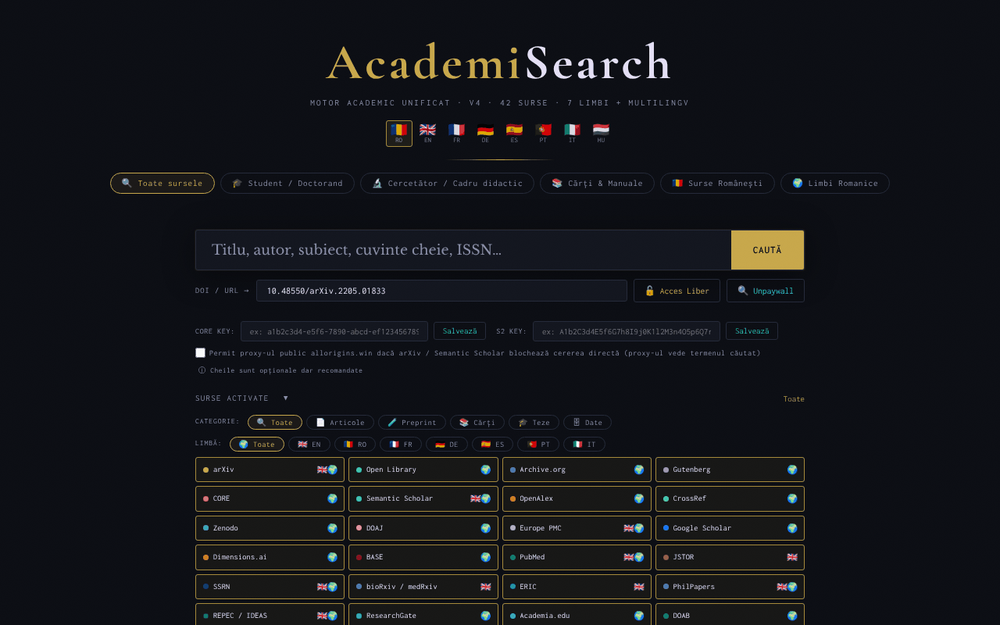

# AcademiSearch

[English](README.md) · **Română** · [Français](README.fr.md) · [Italiano](README.it.md) · [Español](README.es.md) · [Português](README.pt.md) · [Deutsch](README.de.md) · [Magyar](README.hu.md)

**Versiune:** 4.3.3 · **Ultima actualizare:** 2026-10-19

Limbile interfeței: **Română, English, Français, Italiano, Español, Português (PT), Deutsch, Magyar**

Motor de căutare academic unificat, într-un singur fișier HTML: 42 de surse open-access, 8 limbi de interfață.

**Live:** https://chiuta.github.io/AcademiSearch/

## Ce este

AcademiSearch este o aplicație dintr-un singur fișier `index.html` care interoghează simultan mai multe surse academice (articole, preprinturi, cărți, teze, date de cercetare) și afișează rezultatele într-o fereastră comună. Pentru o parte din surse rezultatele sunt aduse direct prin API; pentru restul aplicația oferă link direct către pagina de căutare a portalului respectiv. Conform textului din aplicație, sunt 42 de surse: 11 cu rezultate live prin API și 31 de portaluri cu link direct.

## Funcții

- Interfață în 8 limbi: română, engleză, franceză, germană, spaniolă, portugheză, italiană (butoane RO / EN / FR / DE / ES / PT / IT / HU).
- Presetări de căutare: „Toate sursele", „Student / Doctorand", „Cercetător / Cadru didactic", „Cărți & Manuale", „Surse Românești", „Limbi Romanice".
- Panou „Surse activate" cu bifarea individuală a surselor.
- Filtre după categorie (Articole, Preprint, Cărți, Teze, Date) și după limbă (EN, RO, FR, DE, ES, PT, IT).
- Rezultate cu filtre „Cu PDF" și „Cu DOI" și încărcare progresivă a rezultatelor.
- Câmp „DOI / URL" cu butoanele „Acces Liber" și „Unpaywall": aplicația caută o versiune open-access prin CrossRef (dacă lipsește DOI-ul), Unpaywall, OpenAIRE și căutare după titlu în Unpaywall.
- Câmpuri opționale pentru cheie API CORE și cheie API Semantic Scholar.
- Export al rezultatelor filtrate în BibTeX, RIS sau CSV (fișier generat local în browser, fără cereri de rețea). Lista de autori se exportă așa cum o returnează sursa (unele surse trunchiază lista), iar câmpurile CSV care încep cu `=`, `+`, `-` sau `@` sunt neutralizate.
- Câmpul „DOI / URL" curăță prefixele (`doi:`, `https://doi.org/`) și afișează un mesaj clar când formatul DOI este nevalid.
- Tasta `/` mută focusul în câmpul de căutare; căutările din sesiunea curentă sunt sugerate (nu se salvează nimic).
- Fereastră „Termeni legali & GDPR".

## Funcții noi (4.1.0)

- **Ordonare după relevanță** a rezultatelor filtrate din fereastra de rezultate: căutare locală (BM25, toleranță la greșeli de scriere, diacritice ignorate) peste titlurile și rezumatele deja aduse; potrivirea literală veche rămâne. Nu face nicio cerere de rețea.
- **„Biblioteca mea”**: butoane de salvare/eliminare pe fiecare card; fereastră cu căutare în bibliotecă, export BibTeX / RIS / CSV și ștergere în doi pași. Maximum 500 de înregistrări, păstrate numai în acest browser.
- Copie de siguranță `.fff.json` (modul comun „fff-kit”, local, fără rețea): se deschide din dialogul care apare la clic pe versiunea din subsol (export, export criptat cu parolă, import cu confirmare, ștergerea datelor aplicației). Copia include biblioteca și limba interfeței.
- Textele noi ale bibliotecii sunt în română, engleză, franceză, germană, spaniolă, portugheză și italiană; **traducerile nu au fost verificate de vorbitori nativi.**

## Manual de utilizare

1. Deschideți pagina și alegeți limba interfeței din colțul de sus (RO, EN, FR, DE, ES, PT, IT, HU).
2. Alegeți o presetare (de exemplu „Student / Doctorand") sau deschideți „Surse activate" și bifați manual sursele dorite.
3. Opțional, restrângeți după CATEGORIE și LIMBĂ.
4. Scrieți termenul în câmpul de căutare și apăsați Enter sau butonul „CAUTĂ".
5. În fereastra de rezultate folosiți filtrele „Cu PDF" / „Cu DOI"; închideți cu „Închide" sau tasta Escape.
6. Pentru un articol cunoscut, lipiți DOI-ul sau URL-ul în câmpul „DOI / URL" și apăsați „Acces Liber" (sau „Unpaywall").
7. Pentru CORE și Semantic Scholar puteți introduce cheia API și apăsați „Salvează" (cheile sunt opționale).

## Confidențialitate și rețea

- Local: limba interfeței se păstrează în `localStorage` (`ui_lang`); biblioteca personală, în `localStorage` (`as_library`, maximum 500 de înregistrări, nu părăsește browserul); cheile API introduse se păstrează în `sessionStorage` și dispar la închiderea filei. Aplicația nu folosește cookie-uri.
- Rețea: aplicația NU este offline. La fiecare căutare, termenul căutat este trimis către serviciile externe active, direct din browser: OpenAlex, CrossRef, CORE, Semantic Scholar, arXiv, Europe PMC (ebi.ac.uk), DOAJ, Zenodo, Open Library, Internet Archive, Project Gutenberg (gutendex.com). La „Acces Liber" / „Unpaywall" sunt contactate CrossRef, Unpaywall și OpenAIRE.
- Proxy CORS (opt-in, dezactivat implicit): arXiv și Semantic Scholar sunt interogate direct. Numai dacă bifați explicit „Permit proxy-ul public allorigins.win" (lângă câmpurile pentru chei API; valabil pe durata filei) și browserul blochează cererea directă (CORS), cererea respectivă este retrimisă prin `api.allorigins.win`, care poate vedea URL-ul interogării (termenul căutat). Cheile API nu trec niciodată prin proxy.
- Cererile către OpenAlex și Unpaywall includ adresa de contact a operatorului (`academisearch@alexio.tf`), conform convenției „polite pool".
- Portalurile cu link direct sunt contactate doar dacă deschideți linkul.
- Fonturi/CDN: verificat la audit (2026-10-10): nu există scripturi, fonturi sau stiluri încărcate de la CDN; fonturile sunt integrate, iar politica CSP din pagină (`connect-src`; `script-src` cu hash, fără `unsafe-inline`) limitează cererile la gazdele de mai sus.

## Rulare locală / offline

Descărcați `index.html` și deschideți-l în browser. Interfața pornește local, dar căutarea necesită conexiune la internet.

## Istoric / Changelog

### 18 octombrie 2026 (v4.2.0)
- Nou: legătură de intrare `#q=<termen>` (ex. din Nota Zero) care doar precompletează câmpul de căutare; căutarea nu pornește singură, iar fragmentul se șterge din adresă după citire.

### 18 octombrie 2026 (v4.1.1)
- Surse care nu mai rămân roșii/blocate: arXiv (fără CORS) trece automat pe preprinturile arXiv din OpenAlex; CORE fără cheie trece pe OpenAIRE, apoi pe repozitorii OA din OpenAlex; Semantic Scholar reîncearcă după 429 și apoi trece pe OpenAlex; Gutenberg are timeout 8 s și fallback pe colecția Gutenberg din Archive.org.
- Fiecare sursă are timeout de 30 s, iar motivul erorii apare ca tooltip pe chip-ul roșu.

### 14 octombrie 2026 (v4.1.0)
- Ordonare locală după relevanță în fereastra de rezultate (FFF.search).
- „Biblioteca mea” (cheia `localStorage` `as_library`) cu căutare și export BibTeX/RIS/CSV.
- Copie de siguranță `.fff.json` prin modulele comune (core, label, bundle, search); versiunea afișată în subsol.
- Teste noi: `tests/fff-r8.test.mjs`.

### 12 octombrie 2026 (v4.0.4)
- 4.0.4 — 2026-10-12: versiunea și data ultimei actualizări sunt afișate în aplicație

### 11 octombrie 2026 (v4.0.3)
- Corectat butonul CAUTĂ tăiat pe ecrane de 360 px și mărite țintele tactile mici (butoane, filtre, casete).
- Tasta „/” mută focusul în câmpul de căutare; căutările din sesiunea curentă apar ca sugestii (doar în memorie, nu se salvează).

### 11 octombrie 2026 (v4.0.3)
- Securitate: toate cele 34 de atribute `on*` inline au fost înlocuite cu un dispatcher delegat (`data-act` + un singur listener); politica CSP folosește acum `script-src` cu hash, fără `'unsafe-inline'` pentru scripturi.
- Export BibTeX / RIS / CSV al rezultatelor filtrate; mesaje în toate cele 7 limbi.
- Validare și curățare a câmpului DOI, cu mesaj de eroare accesibil (`role="status"`).

### 11 octombrie 2026 (v4.0.1)
- Accesibilitate: conținutul este încadrat în <main>, sursele sunt acum elemente cu rol `checkbox` valid (axe: 0 violări).
- Avertisment de drepturi de autor adăugat la sursele 101books.club și Scribd Downloader (descriere/tooltip), clarificând că nu sunt surse open-access.
- Versiunea din fereastra „Termeni legali” și data actualizării: 4.0.1, 11 octombrie 2026.

## Licență

MIT — vezi fișierul LICENSE

## Autor

Alexio — Alexandru-Ionuț Chiuță, contact: alexio@trom.tf

## Rezumat

AcademiSearch este un instrument de meta-căutare într-un singur fișier HTML peste 42 de surse academice cu acces deschis (11 cu rezultate API în direct, 31 ca portaluri cu link direct), cu interfață în 8 limbi. Nu este offline: căutările pleacă direct din browser către API-uri terțe, iar arXiv/Semantic Scholar pot folosi proxy-ul CORS allorigins.win doar dacă bifezi explicit o casetă opt-in (dezactivată implicit). Se stochează doar limba interfeței (localStorage) și cheile API opționale (sessionStorage). Licență MIT. Rezultatele filtrate pot fi exportate ca BibTeX, RIS sau CSV (generate local).

Audit rundă 2 (2026-10-11): proxy-ul allorigins.win a devenit opt-in. Audit: 2026-10-10 — verificat codul (cereri de rețea, escapare rezultate API, proxy CORS: cheile API se trimit doar în antet direct, niciodată prin proxy), accesibilitate (axe) și funcționarea (căutare offline: erori de sursă gestionate). Numărul „42 de surse” corespunde: 11 API + 31 portaluri.
